# ARQUITETURA DE SOFTWARE — PLATAFORMA DEMOSTRATIVO MTD
**Especificação Técnica, Padrões Estruturais e Camada de Dados**

---

> [!NOTE]
> **Documento:** Arquitetura Técnica e Guia de Engenharia  
> **Versão:** 9.0.0 (Etapa 9 Concluída — Auditoria Geral, Estabilização e Preparação para Backend)  
> **Status:** Ativo / Vigente  
> **Localização:** Raiz do Projeto (`/demonstrativo-mtd/ARQUITETURA.md`)

---

## 1. Visão Geral da Arquitetura

A arquitetura da plataforma **DEMOSTRATIVO MTD** é estruturada sobre os pilares da **modularidade**, **alta performance**, **desacoplamento de dados**, **repetição espaçada determinística (SRS)**, **estrutura pedagógica configurável**, **comunidade colaborativa moderada**, **gamificação acadêmica de mérito real** e **fidelidade visual ao Design System**. 

Utiliza o paradigma do Next.js 14 com App Router, combinando Server Components (RSC) para cascas estruturais e Client Components (`"use client"`) para interfaces reativas com persistência isomórfica.

```mermaid
flowchart TD
    subgraph UI_Layer ["Camada de Apresentação (UI Layer)"]
        subgraph Aluno_Portal ["Portal do Aluno: src/app/(aluno)"]
            A_Dash["Dashboard (/aluno)"]
            A_Aulas["Minhas Aulas (/aluno/aulas)"]
            A_Materiais["Materiais & Atividades (/aluno/materiais & [id])"]
            A_SelfPres["Self Presentation (/aluno/self-presentation & [id])"]
            A_Flashcards["Flashcards & Prática (/aluno/flashcards & [id] & /estudar)"]
            A_Avaliacoes["Avaliações & Jornada (/aluno/avaliacoes & [id])"]
            A_Comunidade["Comunidade & Intercâmbio (/aluno/comunidade & [id])"]
            A_Conquistas["Conquistas & Placas (/aluno/conquistas & [id])"]
            A_Internas["Páginas Internas (/aluno/*)"]
        end
        subgraph Admin_Portal ["Portal Administrativo: src/app/(admin)"]
            Adm_Dash["Dashboard Geral (/admin)"]
            Adm_Alunos["Alunos (/admin/alunos & [id])"]
            Adm_Profs["Professores (/admin/professores & [id])"]
            Adm_Turmas["Turmas (/admin/turmas & [id])"]
            Adm_Agenda["Agenda Escolar (/admin/agenda)"]
            Adm_Materiais["Materiais & Atividades (/admin/materiais & [id])"]
            Adm_SelfPres["Fila de Self Presentations (/admin/self-presentation & [id])"]
            Adm_Flashcards["Gestão de Baralhos & Cartões (/admin/flashcards & [id])"]
            Adm_Avaliacoes["Método Paulo & Avaliações (/admin/avaliacoes & [id])"]
            Adm_Comunidade["Gestão de Comunidade (/admin/comunidade & [id])"]
            Adm_Conquistas["Gamificação & Placas (/admin/conquistas & [id])"]
        end
    end

    subgraph Modals_Components ["Componentes Interativos & Modais (src/components)"]
        M_ComunidadeModals["PublicacaoFormModal, DenunciaModal, ModeracaoModal"]
        M_GamificacaoModals["ModeloConquistaFormModal, ConcederConquistaManualModal, GerenciarPlacaModal, SolicitarPlacaModal"]
        M_DrawerNotificacoes["NotificacoesDrawer (Header)"]
        M_PlacaDigitalView["PlacaDigitalView (Autenticidade MTD-PLK-XXXX)"]
        Card_AdminComunidade["AdminComunidadeCard"]
        Card_AdminGamificacao["AdminGamificacaoCard"]
        Card_AlunoConquistas["AlunoConquistasSummaryCard"]
        Card_ProgressoJornada["ProgressoJornadaCard"]
        Card_AdminAvaliacoes["AdminAvaliacoesCard"]
        Card_FlashcardsSummary["FlashcardsSummaryCard"]
        Card_FlashcardsAdmin["FlashcardsAdminCard"]
    end

    subgraph Data_Layer ["Camada de Dados, Repositórios e Motores (src/data)"]
        ComunidadeRegras["Regras de Acesso e Moderação: src/data/comunidadeRegras.ts"]
        GamificacaoMotor["Motor de Presença, Streaks e Pontos: src/data/gamificacaoMotor.ts"]
        PedagogicoEngine["Cálculos Pedagógicos Puros: src/data/pedagogicoCalculos.ts"]
        SRSEngine["Motor SRS Inspirado no SM-2: src/data/srsAlgorithm.ts"]
        ComunidadeRepo["ComunidadeRepository: src/data/comunidadeRepository.ts"]
        GamificacaoRepo["GamificacaoRepository: src/data/gamificacaoRepository.ts"]
        ProgramaRepo["ProgramaRepository: src/data/programaRepository.ts"]
        EtapaRepo["EtapaRepository: src/data/etapaRepository.ts"]
        ModuloRepo["ModuloRepository: src/data/moduloRepository.ts"]
        ProgressoModuloRepo["ProgressoModuloRepository: src/data/progressoModuloRepository.ts"]
        AvaliacaoRepo["AvaliacaoRepository: src/data/avaliacaoRepository.ts"]
        TentativaRepo["TentativaAvaliacaoRepository: src/data/tentativaAvaliacaoRepository.ts"]
        BaralhoRepo["BaralhoRepository: src/data/baralhoRepository.ts"]
        CartaoRepo["CartaoRepository: src/data/cartaoRepository.ts"]
        APIService["Serviço Consolidado: src/data/api.ts"]
        MockSeed["Dados Semente: src/data/mockData.ts"]
    end

    subgraph Persistence ["Armazenamento Local Isomórfico"]
        LocalStorage[("Browser LocalStorage (28 Chaves mtd_*_v1)")]
        EventBus["Barramento de Eventos (mtd_storage_updated)"]
    end

    UI_Layer --> Modals_Components
    Modals_Components --> Data_Layer
    Data_Layer --> ComunidadeRegras
    Data_Layer --> GamificacaoMotor
    Data_Layer --> PedagogicoEngine
    Data_Layer --> SRSEngine
    Data_Layer --> LocalStorage
    LocalStorage --> EventBus
    EventBus -. Reatividade em Tempo Real .-> Card_AdminComunidade
    EventBus -. Reatividade em Tempo Real .-> Card_AdminGamificacao
    EventBus -. Reatividade em Tempo Real .-> Card_AlunoConquistas
    EventBus -. Reatividade em Tempo Real .-> Card_ProgressoJornada
    EventBus -. Reatividade em Tempo Real .-> Card_AdminAvaliacoes
    EventBus -. Reatividade em Tempo Real .-> Card_FlashcardsSummary
    EventBus -. Reatividade em Tempo Real .-> M_DrawerNotificacoes
```



---

## 2. Stack Tecnológica Adotada

| Tecnologia | Versão | Justificativa Técnica |
| :--- | :--- | :--- |
| **Next.js** | 14.2+ (App Router) | Roteamento baseado no sistema de arquivos, layouts aninhados, suporte a rotas estáticas (`○`) e dinâmicas (`ƒ` para `[id]`), pré-renderização otimizada. |
| **React** | 18.x | Interface declarativa com hooks reativos (`useState`, `useEffect`, `useCallback`, `useMemo`). |
| **TypeScript** | 5.x | Tipagem estática rigorosa (`strict: true`), contratos estritos para entidades `Aluno`, `Professor`, filtros e resultados operacionais (`OperationResult<T>`). |
| **Tailwind CSS** | 3.4+ | Design system com tokens semânticos (`mtd-navy`, `mtd-purple`, `mtd-slate`), layouts fluidos mobile e desktop. |
| **Lucide React** | Última (v1.59+) | Conjunto consistente de ícones com propriedades de acessibilidade e semântica SVG. |
| **Node.js Test Runner** | 20.x | Validação unitária automatizada sem dependências externas adicionais. |

---

## 3. Organização e Topologia de Pastas

```
demonstrativo-mtd/
├── public/                     # Mídias e fotografias HD
├── scripts/
│   ├── test-etapa3.mjs         # Testes de turmas, agenda e presença
│   ├── test-etapa4.mjs         # Testes de materiais, atividades e presenca
│   ├── test-etapa5.mjs         # Testes de self presentation e desacoplamento CEFR
│   ├── test-etapa6.mjs         # Testes do motor SRS, baralhos, cartões e CSV
│   └── test-etapa7.mjs         # Testes de estrutura pedagógica, avaliações, critérios e validação humana
├── src/
│   ├── app/
│   │   ├── (admin)/
│   │   │   ├── admin/
│   │   │   │   ├── page.tsx            # Dashboard Admin com contadores e AdminAvaliacoesCard
│   │   │   │   ├── alunos/             # Gestão de alunos e histórico pedagógico
│   │   │   │   ├── professores/
│   │   │   │   ├── turmas/
│   │   │   │   ├── agenda/
│   │   │   │   ├── materiais/
│   │   │   │   ├── self-presentation/
│   │   │   │   ├── flashcards/
│   │   │   │   └── avaliacoes/
│   │   │   │       ├── page.tsx        # 4 abas: Método, Avaliações, Fila de Correção e Progresso
│   │   │   │       └── [id]/page.tsx   # Detalhes da avaliação, questões/rubrica e histórico
│   │   │   └── layout.tsx
│   │   ├── (aluno)/
│   │   │   ├── aluno/
│   │   │   │   ├── page.tsx            # Dashboard do Aluno com ProgressoJornadaCard
│   │   │   │   ├── aulas/
│   │   │   │   ├── materiais/
│   │   │   │   ├── self-presentation/
│   │   │   │   ├── flashcards/
│   │   │   │   └── avaliacoes/
│   │   │   │       ├── page.tsx        # Painel de avaliações do aluno e status de submissão
│   │   │   │       └── [id]/page.tsx   # Interface de realização objetiva/prática e feedback
│   │   │   └── layout.tsx
│   │   ├── globals.css
│   │   └── layout.tsx
│   │
│   ├── components/
│   │   ├── admin/
│   │   │   ├── AvaliacaoBadges.tsx     # Badges de tipos, status e resultados avaliativos
│   │   │   ├── MetodoEstruturaModals.tsx # Modais de Programa, Etapa, Módulo e Critérios
│   │   │   ├── AvaliacaoFormModal.tsx  # Construtor de avaliações objetivas e práticas
│   │   │   ├── CorrigirTentativaPraticaModal.tsx # Correção docente com rubrica e feedback
│   │   │   ├── ProgressoAcoesModals.tsx # Modais de Validação, Reabertura e Tentativa Extra
│   │   │   ├── AdminAvaliacoesCard.tsx # Métricas consolidadas de avaliações e fila de correção
│   │   │   ├── BaralhoFormModal.tsx
│   │   │   ├── CartaoFormModal.tsx
│   │   │   └── FlashcardsAdminCard.tsx
│   │   ├── aluno/
│   │   │   ├── ProgressoJornadaCard.tsx # Barra de progresso real (cumpridos / aplicaveis) e checklist
│   │   │   ├── FlashcardStudyCard.tsx
│   │   │   ├── SessaoEstudoConcluidaCard.tsx
│   │   │   └── FlashcardsSummaryCard.tsx
│   │   ├── common/
│   │   └── layout/
│   │
│   ├── data/
│   │   ├── pedagogicoCalculos.ts        # Funções puras de correção objetiva, rubricas e progresso
│   │   ├── srsAlgorithm.ts             # Motor matemático inspirado no SM-2
│   │   ├── programaRepository.ts       # Repositório de programas do Método Paulo
│   │   ├── etapaRepository.ts          # Repositório de etapas com reordenação up/down
│   │   ├── moduloRepository.ts         # Repositório de módulos e critérios de conclusão
│   │   ├── progressoModuloRepository.ts# Progresso individual, validação humana e reabertura
│   │   ├── avaliacaoRepository.ts      # Repositório de avaliações e versionamento imutável
│   │   ├── tentativaAvaliacaoRepository.ts # Fila de correção, tentativas e sanitização
│   │   ├── baralhoRepository.ts
│   │   ├── cartaoRepository.ts
│   │   ├── progressoCartaoRepository.ts
│   │   ├── historicoRevisaoRepository.ts
│   │   ├── sessaoEstudoRepository.ts
│   │   ├── selfPresentationRepository.ts
│   │   ├── historicoNivelRepository.ts
│   │   ├── materialRepository.ts
│   │   ├── atividadeRepository.ts
│   │   ├── entregaRepository.ts
│   │   ├── conteudoDiarioRepository.ts
│   │   ├── turmaRepository.ts
│   │   ├── aulaRepository.ts
│   │   ├── alunoRepository.ts
│   │   ├── professorRepository.ts
│   │   ├── mockData.ts                 # Sementes completas de todas as etapas
│   │   └── api.ts                      # Fachada assíncrona consolidada
│   │
│   └── types/
│       └── index.ts                    # Contratos TypeScript completos
```

---

## 4. Arquitetura da Camada de Dados e Motores Pedagógicos

### 4.1. Motor Determinístico de Repetição Espaçada (Inspirado no SM-2)
- Localizado em `src/data/srsAlgorithm.ts`, opera como função pura sem efeitos colaterais.
- Parâmetros base: fator de facilidade inicial `2.5`, piso mínimo absoluto `1.3`.
- Regras de transição de estado:
  - **Errei (`errei`):** Lapsos incrementados, fator de facilidade reduzido em `0.20` (respeitando o piso 1.3), estado alterado para `aprendendo`, intervalo de 10 minutos (`nextReviewAt = agora + 10 min`). O cartão é reagendado para revisão e não entra em loop forçado na mesma sessão se a prática terminar antes dos 10 minutos.
  - **Difícil (`dificil`):** Fator reduzido em `0.15` (piso 1.3), intervalo de 1 dia para novos/aprendendo ou avanço conservador (`intervalo * 1.2`) para revisões.
  - **Bom (`bom`):** 1 dia no primeiro acerto, 3 dias no segundo, `round(intervalo * fator)` nos subsequentes.
  - **Fácil (`facil`):** Fator acrescido em `0.15`, avanço acelerado (4 dias para novos, `round(intervalo * fator * 1.3)` para revisões).

### 4.2. Construção Determinística da Fila Diária de Estudos
A fila de estudos (`obterFilaEstudoBaralho`) implementa uma esteira estrita de priorização pedagógica:
1. **Revisões Vencidas:** Cartões em estado `revisando` com `proximaRevisao <= agora`, ordenados do mais atrasado para o mais recente.
2. **Aprendizado Vencido:** Cartões em estado `aprendendo` com `proximaRevisao <= agora`.
3. **Novos Cartões:** Cartões em estado `novo`, limitados à cota diária do baralho (`limiteDiarioNovos`).
4. **Exclusões:** Cartões suspensos (`status = 'suspenso'`) ou com revisão futura agendada são estritamente excluídos da fila.

### 4.3. Motor de Cálculos Pedagógicos Puros (`src/data/pedagogicoCalculos.ts`)
- **Correção Objetiva:** Proporcionalidade estrita: $(\text{pontosObtidos} / \text{pontosTotais}) \times \text{notaMaximaConfigurada}$.
- **Avaliação Prática por Rubrica:** Pontuação atribuída pelo professor por critério normalizada para a escala máxima da atividade.
- **Progresso de Módulo:** Percentual calculado como $(\text{criteriosCumpridos} / \text{totalCriteriosAplicaveis}) \times 100$.
- **Barreira Humana:** Quando `exigeValidacaoHumana === true`, o atingimento de 100% dos critérios matemáticos mantém o módulo no status `aguardando_validacao` até que ocorra aprovação formal pelo professor (`validarConclusaoProfessor`).
- **Reabertura:** Módulos concluídos podem ser reabertos (`reaberto`) para reforço mediante justificativa obrigatória salva em log de auditoria.
- **Imutabilidade e Versionamento:** Avaliações que possuem tentativas não têm seus enunciados ou rubricas sobrescritos diretamente; são duplicadas em novas versões ($v+1$).

### 4.4. Isomorfismo e Persistência no LocalStorage (21 Chaves)
- O armazenamento utiliza 21 chaves dedicadas (`mtd_demonstrativo_*_v1`).
- Suporte a SSR com retorno seguro de sementes mockadas durante a compilação.
- Tratamento de exceções com `try/catch` seguro retornando `OperationResult<T>`.

### 4.5. Barramento de Eventos para Consistência Reativa
- Operações de escrita emitem `window.dispatchEvent(new CustomEvent("mtd_storage_updated", { detail: { entity } }))`.
- Dashboards e contadores reagem em tempo real sem necessidade de recarregar a página.

### 4.6. Configuração e Controle do Modo Demonstrativo (Etapa 9)
- **Flag Central:** `NEXT_PUBLIC_DEMO_MODE=true` (em `src/lib/demoMode.ts`).
- **Comportamento em Modo Demonstrativo (`true`):**
  - Seletor visual `DemoRoleSwitcher` disponível.
### 4.7. Motor de Priorização da Fila Administrativa (`src/data/adminPendenciasMotor.ts`)
- **Natureza Pura e Determinística:** Função `calcularFilaPendenciasAdmin(dados)` independente de estado de interface React, sem efeitos colaterais e testada por suíte dedicada.
- **Hierarquia de 7 Prioridades:**
  1. `denuncia_comunidade`: Moderação de segurança e integridade (urgência máxima).
  2. `self_presentation`: Nivelamento oral submetido aguardando avaliação e parecer do professor.
  3. `aula_sem_zoom`: Aula nas próximas 24 horas sem link de reunião verificado.
  4. `validacao_modulo`: Módulo com 100% dos critérios cumpridos aguardando barreira humana.
  5. `avaliacao_pratica`: Avaliação discursiva/prática entregue aguardando correção docente.
  6. `atividade_pratica`: Atividade prática pendente de análise pedagógica.
  7. `placa_reconhecimento`: Placa de conquista física aguardando solicitação e despacho logístico.
- **Isolamento de Layout Executivo:**
  - Sidebar administrativa fixa em desktop (`sticky top-0 h-screen overflow-y-auto`).
  - Painel dividido em grade de 12 colunas com cartões pareados de mesma altura.
  - Purga completa de dados demonstrativos incoerentes (substituição de matérias de ensino fundamental por módulos exclusivos de inglês do Método Paulo).


---

## 5. Regras de Segurança e Privacidade na Etapa Atual

1. **Proibição de Credenciais no Cliente:** Nenhuma senha, token JWT ou segredo de autenticação é persistido no `localStorage`.
2. **Dados Demonstrativos:** Todas as entidades utilizam dados fictícios para demonstração do fluxo educacional.
3. **Soft Delete Mandatório:** Registros são suspensos ou inativados; exclusões definitivas que quebrem integridade referencial são bloqueadas.
4. **Sanitização de Privacidade:** Observações pedagógicas internas e notas confidenciais são estritamente destruídas e expurgadas antes de qualquer retorno ou renderização para o discente (`sanitizarTentativaParaAluno`).
5. **Parser CSV Local:** A importação de cartões ocorre 100% no navegador via leitura de arquivos locais (`FileReader`), sem upload para servidores.
6. **Links Externos HTTPS:** Validação via parser nativo `new URL()` com abertura em nova aba com `rel="noopener noreferrer"`.
7. **Isolamento de Pontos da Comunidade:** Nenhuma interação na comunidade (posts, comentários, reações, denúncias) gera pontos de gamificação.
8. **Reações Limitadas:** Cada usuário tem direito a exatamente 1 reação por publicação, com alternância inteligente (toggle off) e substituição direta.

---

## 6. Documentação Arquitetural de Transição (Etapa 9)

A plataforma conta com um conjunto completo de especificações para a migração para backend:
* **`MAPA_DO_SISTEMA.md`**: Inventário completo de rotas, entidades, relacionamentos e componentes.
* **`AUDITORIA_ETAPA_9.md`**: Relatório de consistência e severidade classificando e corrigindo itens críticos, altos e médios.
* **`PLANO_MIGRACAO_BACKEND.md`**: Roteiro de migração repositório por repositório em 6 fases de integridade.
* **`MODELO_DE_DADOS.md`**: Schema DDL PostgreSQL completo com constraints, índices B-Tree, soft delete e auditoria.
* **`MATRIZ_DE_PERMISSOES.md`**: Matriz RBAC para 4 papéis (Admin, Coordenação, Professor e Aluno) sobre 8 operações.
* **`DECISAO_DE_INFRAESTRUTURA.md`**: Análise comparativa imparcial dos 14 critérios entre Vercel+Supabase e OneX VPS.
* **`.env.example`**: Modelo de variáveis de ambiente sem credenciais ou segredos.

---

## 7. Pipeline de Estilização, Tailwind CSS e Resolução de Falhas

### 7.1. Como o CSS Global é Carregado
- O arquivo raiz `src/app/layout.tsx` contém uma importação estática, incondicional e síncrona no topo:
  ```typescript
  import "./globals.css";
  ```
- O arquivo `src/app/globals.css` declara as diretivas fundamentais do Tailwind:
  ```css
  @tailwind base;
  @tailwind components;
  @tailwind utilities;
  ```
- O compilador Next.js extrai e agrupa o CSS em `/_next/static/css/app/layout.css`, injetando a tag `<link rel="stylesheet">` no `<head>` do HTML servido.

### 7.2. Versão do Tailwind CSS
- **Versão:** Tailwind CSS `v3.4.1` (Tailwind 3).
- **Processamento:** PostCSS 8 gerenciado por `postcss.config.mjs`:
  ```javascript
  const config = { plugins: { tailwindcss: {} } };
  export default config;
  ```
- **Escaneamento de Conteúdo (`tailwind.config.ts`):** Mapeia estritamente:
  `./src/pages/**/*.{js,ts,jsx,tsx,mdx}`, `./src/components/**/*.{js,ts,jsx,tsx,mdx}` e `./src/app/**/*.{js,ts,jsx,tsx,mdx}`.

### 7.3. Conflitos de Portas e Servidores Concorrentes
- Se um processo `next dev` for iniciado enquanto outro já estiver rodando, o novo processo vinculará automaticamente à porta `3001` (ou superior).
- **Risco:** Dois servidores lendo e gravando simultaneamente na mesma pasta `.next/` corrompem o cache do webpack e invalidam os hashes de CSS.
- **Diagnóstico:**
  ```bash
  lsof -i :3000
  lsof -i :3001
  ```
- **Resolução:** Encerrar instâncias órfãs (`kill <PID>`) antes de iniciar um novo servidor.

### 7.4. Quando e Como Utilizar `npm run dev:fresh`
- Quando houver erro de chunk desatualizado (ex: `Cannot find module './XXXX.js'`) ou quando arquivos de estilo retornarem `404`:
  ```bash
  npm run dev:fresh
  ```
- O script seguro `scripts/clean-next-cache.mjs` valida a integridade do caminho e remove **exclusivamente** a pasta `.next` do projeto antes de inicializar o `next dev`.

### 7.5. Diagnóstico de Falha de CSS pela Aba Network
1. Abrir o DevTools (F12) > Aba **Network** > Filtrar por **CSS**.
2. Recarregar a página com *Hard Refresh* (`Cmd+Shift+R` ou `Ctrl+F5`).
3. Verificar a requisição para `/_next/static/css/...`:
   - **Status 200 OK (MIME `text/css`):** Estilos compilados e aplicados com sucesso.
   - **Status 404 Not Found:** Cache do webpack dessincronizado após build concorrente ou término incorreto do servidor dev. Executar `npm run dev:fresh`.
   - **Status 500:** Falha de compilação em página ou módulo do Next.js.
4. Verificar se há tentativa de requisição de `sw.js` (Service Worker órfão no navegador de outro projeto na porta 3000): limpar dados do site em DevTools > Application > Storage > Clear site data.


