# PLANO DE DESENVOLVIMENTO — PLATAFORMA DEMOSTRATIVO MTD
**Roadmap Estratégico, Ciclo de Entregas e Critérios de Conclusão**

---

> [!NOTE]
> **Documento:** Plano Diretor de Desenvolvimento e Roadmap Técnico  
> **Versão:** 9.0.0 (Etapa 9 Concluída — Auditoria Geral, Estabilização e Preparação para Backend)  
> **Status:** Ativo / Vigente  
> **Localização:** Raiz do Projeto (`/demonstrativo-mtd/PLANO_DE_DESENVOLVIMENTO.md`)

---

## 1. Visão Geral do Roadmap

O desenvolvimento da plataforma **DEMOSTRATIVO MTD** é estruturado em etapas incrementais e progressivas para garantir a absorção segura da metodologia do Método Paulo tanto pelos discentes quanto pelo corpo docente:

```mermaid
flowchart LR
    E1["Etapa 1<br/><b>Design & Dashboards</b><br/>(Concluída)"] --> E2["Etapa 2<br/><b>Cadastros Alunos & Docentes</b><br/>(Concluída)"]
    E2 --> E3["Etapa 3<br/><b>Turmas, Agenda & Presença</b><br/>(Concluída)"]
    E3 --> E4["Etapa 4<br/><b>Materiais, Atividades & Feedback</b><br/>(Concluída)"]
    E4 --> E5["Etapa 5<br/><b>Self Presentation & Nivelamento</b><br/>(Concluída)"]
    E5 --> E6["Etapa 6<br/><b>Flashcards SRS</b><br/>(Concluída)"]
    E6 --> E7["Etapa 7<br/><b>Estrutura Pedagógica & Avaliações</b><br/>(Concluída)"]
    E7 --> E8["Etapa 8<br/><b>Comunidade & Conquistas</b><br/>(Concluída)"]
    E8 --> E9["Etapa 9<br/><b>Auditoria & Prep Backend</b><br/>(Concluída)"]
    E9 --> E10["Etapa 10<br/><b>Backend, RBAC & Deploy</b><br/>(PostgreSQL + Produção)"]

    style E1 fill:#EEF2FF,stroke:#4F46E5,stroke-width:2px,color:#312E81
    style E2 fill:#ECFDF5,stroke:#10B981,stroke-width:2px,color:#065F46
    style E3 fill:#ECFDF5,stroke:#10B981,stroke-width:2px,color:#065F46
    style E4 fill:#ECFDF5,stroke:#10B981,stroke-width:2px,color:#065F46
    style E5 fill:#ECFDF5,stroke:#10B981,stroke-width:2px,color:#065F46
    style E6 fill:#ECFDF5,stroke:#10B981,stroke-width:2px,color:#065F46
    style E7 fill:#ECFDF5,stroke:#10B981,stroke-width:2px,color:#065F46
    style E8 fill:#ECFDF5,stroke:#10B981,stroke-width:2px,color:#065F46
    style E9 fill:#ECFDF5,stroke:#10B981,stroke-width:2px,color:#065F46
    style E10 fill:#F8FAFC,stroke:#64748B,stroke-width:1px,color:#0F172A
```

---

## 2. Detalhamento das Etapas

---

### ETAPA 1 (CONCLUÍDA): Estrutura Base, Identidade Visual e Dashboards Demonstrativos
* **Objetivo:** Estabelecer a infraestrutura Next.js 14 App Router, o Design System MTD de alta fidelidade visual, os dashboards demonstrativos (`/aluno` e `/admin`) e a navegação responsiva.
* **Status:** Concluída e aprovada.

---

### ETAPA 2 (CONCLUÍDA): Cadastros de Alunos e Professores com Persistência Local
* **Objetivo:** Implementar os fluxos cadastrais completos para alunos e professores no painel administrativo, com validações de unicidade de e-mail, normalização de dados, avisos pedagógicos de CEFR, avisos de vinculação de credenciais e persistência segura no navegador.
* **Status:** Concluída e aprovada.

---

### ETAPA 3 (CONCLUÍDA): Turmas, Matrículas, Agenda, Aulas e Presença
* **Objetivo:** Transformar os cadastros existentes em uma operação escolar funcional completa: criação e gerenciamento de turmas, matrículas, grade horária, agendamento de sessões com prevenção de conflitos, inserção manual de links do Zoom e lista de chamada digital.
* **Status:** Concluída e aprovada.

---

### ETAPA 4 (CONCLUÍDA): Materiais Didáticos, Atividades, Entregas e Feedback Pedagógico
* **Objetivo:** Estabelecer a biblioteca de conteúdos didáticos do Método Paulo, publicação direcionada (turma, aluno ou geral), gestão de atividades com prazos e políticas de atraso, submissão de respostas pelos discentes, esteira de correção/feedback pelos professores com retenção histórica de reenvios, estímulos diários e sincronização dos dashboards.
* **Status:** Concluída e aprovada.

---

### ETAPA 5 (CONCLUÍDA): Self Presentation, Avaliação Pedagógica e Nivelamento Inicial
* **Objetivo:** Gerenciar o rito central de fluência: envio de gravação em vídeo pelo discente com validação HTTPS nativa, consentimento formal obrigatório, fila administrativa com ordenação de atendimento, avaliação qualitativa por rubrica analítica de 6 critérios, parecer orientativo, aplicação explícita ao perfil do aluno com histórico de auditoria e ciclo de reenvio versionado.
* **Correção Obrigatória Integrada:** Desacoplamento estrito entre a média dos critérios orais e o nível CEFR (sem conversão ou sugestão automática). Nível operacional 100% manual com justificativa pedagógica obrigatória.
* **Status:** Concluída e aprovada.

---

### ETAPA 6 (CONCLUÍDA): Sistema de Flashcards com Repetição Espaçada (SRS)

* **Objetivo:** Desenvolver o sistema proprietário de flashcards e repetição espaçada da escola MTD para retenção acelerada de vocabulário e expressões idiomáticas, baseado em algoritmo determinístico SM-2 puro, com gestão de baralhos, fila diária de estudos, ambiente interativo de prática e sincronização em tempo real nos dashboards.
* **Entregas Realizadas:**
  - [x] **Correção Obrigatória da Etapa 5 Implementada:** Remoção definitiva de qualquer conversão automática de média da rubrica para CEFR, inclusão de aviso de que a Self Presentation avalia produção oral e não certifica CEFR, testes automatizados garantindo desacoplamento.
  - [x] **Motor Algorítmico SRS Puro (`src/data/srsAlgorithm.ts`):** Implementação determinística inspirada no SM-2 (sem conexão ou integração com o software Anki):
    - *Errei:* lapsos incrementados, fator -0.20 (piso 1.3), estado para `aprendendo`, intervalo de 10 min e re-enfileiramento imediato na mesma sessão.
    - *Difícil:* fator -0.15 (piso 1.3), avanço de 1 dia para novos ou conservador (`intervalo * 1.2`) para revisões.
    - *Bom:* 1 dia no 1º acerto, 3 dias no 2º, multiplicação pelo fator nos subsequentes.
    - *Fácil:* fator +0.15, 4 dias para novos e bônus de 1.3x para revisões.
  - [x] **Gestão Administrativa de Baralhos (`/admin/flashcards` e `[id]`):**
    - Listagem de baralhos com busca, filtros por nível e categoria, métricas de cartões e status.
    - Modal `BaralhoFormModal` com validação de limite diário de novos cartões (1 a 100, padrão 20), nível e destinação (geral, turma ou aluno individual).
    - Modal `CartaoFormModal` com frente, verso, exemplo contextualizado, tradução, dica fonética, pronúncia e link de áudio HTTPS opcional.
    - Modal `ImportarCartoesCSVModal` com parser CSV 100% executado no navegador, sem upload para servidores externos, com validação de cabeçalho, detecção de duplicatas e pré-visualização em tabela.
    - Gestão de cartões com suspensão e reativação (`status: 'suspenso' | 'ativo'`) e soft delete seguro.
  - [x] **Ambiente do Aluno (`/aluno/flashcards`, `[id]` e `[id]/estudar`):**
    - Hub do aluno com métricas da fila diária (vencidos, aprendizado, novos), streak de dias únicos consecutivos e baralhos autorizados.
    - Ficha do baralho (`/aluno/flashcards/[id]`) com status da fila, histórico de sessões anteriores e CTA "Iniciar Sessão".
    - Interface focada de estudo (`/aluno/flashcards/[id]/estudar`): card com rotação (flip), bloqueio estrito de botões SRS antes da revelação, atalhos de teclado (`Espaço` e `1, 2, 3, 4`), estimativas de tempo visíveis em cada botão e cronômetro em tempo real.
    - Re-enfileiramento automático: cartões avaliados como "Errei" voltam ao final da fila para consolidação imediata antes de concluir a sessão.
    - Tela de fechamento `SessaoEstudoConcluidaCard` com total de cartões praticados, tempo decorrido, taxa de retenção e explicação pedagógica do SRS.
  - [x] **Integridade de Áudio:** Áudios somente reproduzíveis se houver link HTTPS externo válido; caso contrário o botão é omitido ou desativado sem simular áudio falso.
  - [x] **Sincronização em Tempo Real nos Dashboards:**
    - Dashboard do Aluno (`/aluno`): Card `FlashcardsSummaryCard` com streak em dias, cartões para hoje e atalho de prática.
    - Dashboard Administrativo (`/admin`): Card `FlashcardsAdminCard` com métricas consolidadas e lista de cartões mais desafiadores para intervenção pedagógica.
  - [x] **Bateria de Testes Automatizados (`scripts/test-etapa6.mjs`):** 8 suítes com 100% de sucesso cobrindo motor SRS, fila diária, permissões, importação CSV, suspensão, streak e desacoplamento CEFR.
* **Status:** Concluída e aprovada.

---

### ETAPA 7 (CONCLUÍDA): Estrutura Pedagógica, Avaliações e Progresso

* **Objetivo:** Estabelecer a espinha dorsal metodológica do Método Paulo através de estrutura hierárquica configurável (Programas, Etapas e Módulos), avaliações mistas (objetivas e práticas), critérios de conclusão flexíveis, barreira de validação humana e controle individual do progresso do aluno.
* **Entregas Realizadas:**
  - [x] **Correção Obrigatória da Etapa 6 Implementada:** Reagendamento de 10 minutos após "Errei" inspirado nos princípios do SM-2, sem duplicação imediata na mesma sessão, com avanço limpo e finalização natural caso os outros cartões terminem antes dos 10 minutos.
  - [x] **Estrutura Configurável do Método Paulo:** Entidades `Programa`, `Etapa` e `Modulo` gerenciáveis no painel administrativo, com nomes demonstrativos claramente identificados como editáveis, reordenação ordinal (subir/descer) e status operacionais.
  - [x] **Critérios de Conclusão de Módulo & Cálculo de Progresso:** Configuração de metas flexíveis (aulas, atividades entregues, nota mínima objetiva, nota mínima prática, flashcards revisados) e cálculo visual exato: $(\text{cumpridos} / \text{aplicaveis}) \times 100$.
  - [x] **Barreira de Validação Humana do Professor:** Quando o módulo exige validação humana, atingir 100% dos critérios matemáticos transiciona o módulo para `aguardando_validacao`. O avanço definitivo para `concluido` requer aprovação explícita pelo professor via modal de validação com parecer pedagógico.
  - [x] **Reabertura de Módulo com Justificativa:** Professores podem reabrir módulos concluídos (`reaberto`) para reforço pedagógico mediante justificativa formal registrada no histórico.
  - [x] **Avaliações Objetivas com Correção Automática:** Questões de múltipla escolha com 2 a 6 alternativas, gabarito único, pontuação por questão, explicações detalhadas e cálculo proporcional da nota final: $(\text{pontosObtidos} / \text{pontosTotais}) \times \text{notaMaxima}$.
  - [x] **Avaliações Práticas com Rubrica e Avaliação Humana:** Desafios práticos por rubrica multicritério, fila de correção docente, cálculo proporcional de nota, feedback qualitativo estruturado e notas confidenciais internas da equipe pedagógica.
  - [x] **Sanitização de Privacidade:** Observações pedagógicas internas e confidenciais são estritamente destruídas e expurgadas antes de qualquer retorno ou exibição ao aluno (`sanitizarTentativaParaAluno`).
  - [x] **Versionamento Imutável de Avaliações:** Proteção de histórico com bloqueio de edições em avaliações com submissões e duplicação em novas versões ($v+1$) nascendo como rascunho.
  - [x] **Gestão de Tentativas e Tentativas Extras:** Controle de teto máximo de tentativas por aluno e concessão auditada de tentativas extras por professores.
  - [x] **Integração em Tempo Real nos Dashboards:**
    - Dashboard do Aluno (`/aluno`): Card `ProgressoJornadaCard` com módulo atual, barra de progresso real e checklist de critérios.
    - Dashboard Administrativo (`/admin`): Card `AdminAvaliacoesCard` com métricas consolidadas, fila de correção prática e fila de validação de módulos.
    - Detalhes do Aluno (`/admin/alunos/[id]`): Painel de Jornada no Método Paulo e histórico de tentativas em avaliações.
  - [x] **Rotas Implementadas:**
    - `/admin/avaliacoes`: 4 abas (Estrutura do Método, Avaliações, Tentativas & Fila de Correção, Progresso dos Alunos).
    - `/admin/avaliacoes/[id]`: Detalhes da avaliação, explorador de questões/rubricas e histórico de tentativas.
    - `/aluno/avaliacoes`: Hub do aluno com filtros e status de tentativas.
    - `/aluno/avaliacoes/[id]`: Interface interativa de realização, salvamento de rascunhos, auto-correção objetiva e visualização de feedback.
  - [x] **Bateria de Testes Automatizados (`scripts/test-etapa7.mjs`):** 10 suítes de testes com 100% de sucesso cobrindo CRUD do método, cálculo de critérios, auto-correção objetiva, rubricas práticas, versionamento, controle de tentativas, barreira humana, reabertura, privacidade e regressão SM-2.
* **Status:** Concluída e aprovada.

---

### ETAPA 8 (CONCLUÍDA): Comunidade Exclusiva, Gamificação Acadêmica, Conquistas e Placas

* **Objetivo:** Implementar a rede social interna segmentada para interação discente e comunicados da escola, aliada a um motor de gamificação por mérito pedagógico real (pontos, streaks, horas de presença) e emissão de placas digitais e físicas com código de autenticidade.
* **Entregáveis da Etapa 8:**
  - [x] **Correção Obrigatória da Etapa 7:** Políticas de exibição de gabarito para avaliações objetivas (`nota_imediata`, `gabarito_imediato`, `gabarito_apos_encerramento`), congelamento de política por versão de tentativa e bloqueio de vazamento de respostas em tentativas ativas.
  - [x] **Módulo de Comunidade Interna:**
    - Espaços segmentados: Geral, Turma, Nível Operacional, Objetivo de Carreira e Vitrine de Oportunidades Internacionais.
    - Publicações ricas com tipos (discussão, comunicado oficial, conteúdo/dicas, oportunidade) e validação nativa de links externos HTTPS.
    - Comentários em thread linear, reações estruturadas (*Gostei, Apoio, Parabéns*) e sistema discente de denúncias com moderação administrativa sigilosa.
    - Registro de interesse em intercâmbios e acompanhamento operacional pela equipe.
  - [x] **Módulo de Gamificação, Conquistas e Placas:**
    - Tabela oficial de pontuação pedagógica e histórico de eventos de pontos (`EventoPontos`).
    - Motor de cálculo de horas de presença em aulas (somente aulas concluídas com presença confirmada, zero para faltas/justificativas, com deduplicação por ID).
    - Motor de cálculo de streak contínuo de revisões diárias de flashcards e total de revisados.
    - Desacoplamento CEFR estrito: horas, pontos ou streaks NUNCA concedem ou alteram nível CEFR; marcos de nível dependem exclusivamente de parecer docente no histórico oficial.
    - Catálogo de conquistas configurável com badges digitais, placas digitais com selo comemorativo e código único `MTD-PLK-XXXX`.
    - Gestão administrativa do ciclo de 8 estágios da placa física (elegível, interesse registrado, em análise, aprovado, produção a laser, pronta, enviada com rastreio, entregue/cancelada).
    - Aviso explícito de ausência de integração logística (processamento e remessa conduzidos privadamente pela equipe da escola).
    - Central de Notificações Internas com drawer interativo no `Header` e cards nos dashboards.
  - [x] **Rotas Implementadas:**
    - `/admin/comunidade` e `/admin/comunidade/[id]`
    - `/aluno/comunidade` e `/aluno/comunidade/[id]`
    - `/admin/conquistas` e `/admin/conquistas/[id]`
    - `/aluno/conquistas` e `/aluno/conquistas/[id]`
  - [x] **Bateria de Testes Automatizados (`scripts/test-etapa8.mjs`):** 100% de sucesso cobrindo as políticas de gabarito, regras de acesso a espaços, sanitização de links HTTPS e denúncias, motores de horas de presença, streak, pontos, desacoplamento CEFR e máquina de estados da placa física.
* **Status:** Concluída e aprovada.

---

### ETAPA 9 (CONCLUÍDA): Auditoria Geral, Estabilização e Preparação para Backend
* **Objetivo:** Auditar todas as entidades e fluxos das Etapas 1 a 8, aplicar correções da comunidade e gamificação, padronizar modo demonstrativo versus produção, expurgar riscos de dados sensíveis e preparar especificações arquiteturais para a transição definitiva para PostgreSQL.
* **Escopo Executado:**
  - [x] **Correções Obrigatórias da Etapa 8:**
    - Remoção de pontos por participação na comunidade (zero pontos para posts, comentários, reações, denúncias).
    - Substituição completa de "Ofensiva" por "Sequência de estudos" e "Sequência de flashcards" em toda a UI.
    - Substituição de "Código de autenticidade" por "Identificador demonstrativo" com disclaimer de validação futura.
    - Limite de 1 reação por publicação por usuário, com substituição e desmarcação (toggle off).
  - [x] **Modo Demonstrativo vs Produção:**
    - Implementação de `NEXT_PUBLIC_DEMO_MODE=true` e bloqueio com `ModoProducaoAviso` quando desativado.
  - [x] **Auditoria e Estabilização:**
    - Checagem exaustiva de integridade referencial, dados órfãos e expurgo de observações internas para alunos.
    - Comprovação de zero componentes ou repositórios órfãos.
  - [x] **Documentação Arquitetural Produzida:**
    - `MAPA_DO_SISTEMA.md`, `AUDITORIA_ETAPA_9.md`, `PLANO_MIGRACAO_BACKEND.md`, `MODELO_DE_DADOS.md`, `MATRIZ_DE_PERMISSOES.md`, `DECISAO_DE_INFRAESTRUTURA.md`, `.env.example`.
  - [x] **Bateria de Testes Automatizados (`scripts/test-etapa9.mjs`):** 100% de aprovação nas 7 jornadas completas e testes de filtros de permissão demonstrativa.
* **Status:** Concluída e aprovada.

---

### ETAPA 10: Backend Definitivo, Segurança, RBAC e Deploy em Produção

* **Objetivo:** Conectar a interface a banco relacional (PostgreSQL), implementar autenticação rigorosa (NextAuth.js/JWT HttpOnly), isolamento de permissões entre discentes e corpo docente, e publicação em produção.
* **Status:** Planejada para etapa posterior.

---

## 3. Matriz Síntese de Marcos e Status

| Etapa | Módulo Principal | Entregáveis Chave | Status |
| :---: | :--- | :--- | :--- | :---: |
| **1** | Fundação e Dashboards | Identidade visual, navegação responsiva e dashboards de alta fidelidade | **CONCLUÍDA** |
| **2** | Cadastros de Alunos e Professores | Listagem, filtros, criação, edição, detalhes, inativação e persistência local | **CONCLUÍDA** |
| **3** | Turmas, Agenda e Presença | Turmas individuais/grupo, grade horária, detecção de conflitos e chamada em 4 estados | **CONCLUÍDA** |
| **4** | Materiais Didáticos e Atividades | Biblioteca, entregas, prazos, esteira de correção, reenvios e conteúdos diários | **CONCLUÍDA** |
| **5** | Self Presentation e Nivelamento | Vídeo oral, consentimento, rubricas de 6 critérios, nivelamento CEFR e auditoria | **CONCLUÍDA** |
| **6** | Flashcards SRS | Algoritmo determinístico SM-2, baralhos, fila diária, estudo interativo e CSV | **CONCLUÍDA** |
| **7** | Estrutura Pedagógica & Avaliações | Método Paulo, avaliações mistas, critérios de conclusão, barreira humana e progresso | **CONCLUÍDA** |
| **8** | Comunidade e Conquistas | Feed seguro, moderação, pontos reais, streak, badges e placas físicas (8 estágios) | **CONCLUÍDA** |
| **9** | Auditoria e Preparação para Backend | Correções da Etapa 8, estabilização, 7 jornadas E2E e 6 artefatos de transição | **CONCLUÍDA** |
| **10** | Backend, RBAC e Deploy | Banco relacional, autenticação segura LGPD e ambiente produtivo | Planejada |

---

## 4. Definição de Pronto (Definition of Done — DoD)

Para a homologação oficial de cada etapa, os seguintes critérios foram cumpridos:
1. **Tipagem Estrita:** Zero erros no compilador TypeScript (`npx tsc --noEmit`).
2. **Qualidade de Código:** Zero advertências ou erros no linter (`npm run lint`).
3. **Build de Produção:** Build de produção Next.js concluído com sucesso (`npm run build`).
4. **Baterias de Testes Automatizados:** 100% de sucesso nas suítes automatizadas (`scripts/test-etapa*.mjs`).
5. **Persistência Isomórfica e Integridade:** Estado mantido com segurança no `localStorage` após recarregamento.
6. **Segurança e Privacidade:** Sanitização estrita de observações pedagógicas internas e validação nativa de links HTTPS.
7. **Transparência Pedagógica:** Avisos explícitos de que o nivelamento oral interno é orientativo e não substitui certificação formal CEFR.
