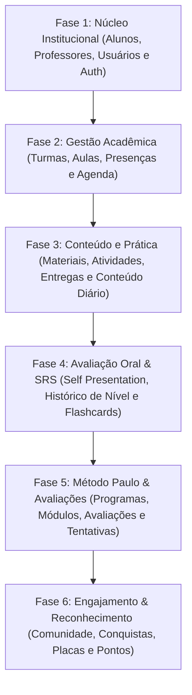

# PLANO DE MIGRAÇÃO PARA BACKEND • DEMOSTRATIVO MTD
**Versão:** 9.0.0 (Etapa 9 — Arquitetura de Transição)  
**Data:** 18 de Outubro de 2026  
**Finalidade:** Guia técnico definitivo para substituição do `localStorage` por PostgreSQL e API backend  

---

## 1. Visão Geral da Estratégia

Atualmente, toda a camada de dados reside em `src/data/`, onde os repositórios assíncronos (`Promise<T>`) implementam o armazenamento em `localStorage` ou memória. Como os componentes da interface (`src/components/` e `src/app/`) interagem estritamente com os contratos de repositório, a migração para backend consiste em **substituir a implementação interna das funções de repositório** por chamadas HTTP (ex: `fetch('/api/...')`) ou chamadas diretas ao cliente do banco/ORM (ex: Prisma, Supabase Client), sem alterar a camada visual.

---

## 2. Ordem Recomendada de Migração (Fases de Dependência)

A migração deve seguir estritamente a ordem de dependência das entidades no banco relacional para garantir a integridade das chaves estrangeiras:

---

## 3. Especificação Repositório por Repositório

### Fase 1: Núcleo Institucional e Usuários

#### 1. `alunoRepository`
* **Tabela no Banco:** `alunos` (relacionada a `auth.users`)
* **Operações Utilizadas:** `listar`, `obterPorId`, `criar`, `atualizar`, `inativar`, `atualizarNivelOperacional`.
* **Relacionamentos:** 1:N com `turma_alunos`, `aulas_chamada`, `entregas`, `self_presentations`, `historico_niveis`, `progresso_modulos`, `conquistas_concedidas`.
* **Regras de Negócio no Servidor:** Validação de duplicidade de e-mail; sanitização de telefone; integridade de status.
* **Dados Confidenciais:** E-mail pessoal, telefone e `observacoesInternas` (confidenciais à equipe escolar).
* **Política de Acesso Futura (RLS):**
  - Aluno: `SELECT` restrito ao seu próprio registro (`id = auth.uid()`).
  - Professor / Coordenação / Admin: `SELECT`, `UPDATE` de observações e nível.

#### 2. `professorRepository`
* **Tabela no Banco:** `professores` (relacionada a `auth.users`)
* **Operações Utilizadas:** `listar`, `obterPorId`, `criar`, `atualizar`, `inativar`.
* **Relacionamentos:** 1:N com `turmas`, `aulas`, `avaliacoes_corrigidas`.
* **Regras de Negócio no Servidor:** Verificação de e-mail corporativo único.
* **Dados Confidenciais:** Telefone e anotações administrativas de contratação.
* **Política de Acesso Futura:**
  - Público/Aluno: `SELECT` de nome, avatar e biografia pública.
  - Admin/Coordenação: CRUD completo.

---

### Fase 2: Gestão Acadêmica

#### 3. `turmaRepository`
* **Tabelas no Banco:** `turmas` e `turma_alunos` (tabela de junção)
* **Operações Utilizadas:** `listar`, `obterPorId`, `listarPorAluno`, `criar`, `atualizar`, `matricularAluno`, `desmatricularAluno`.
* **Relacionamentos:** N:1 com `professores`; N:M com `alunos`; 1:N com `aulas`.
* **Regras de Negócio no Servidor:** Validação de limite máximo de vagas (turma individual = 1, grupo = 6); prevenção de sobreposição de horários do professor e dos alunos; proibição de exclusão de turma com histórico de aulas.
* **Dados Confidenciais:** Nenhum (dados pedagógicos coletivos).
* **Política de Acesso Futura:**
  - Aluno: visualiza apenas as turmas em que está matriculado.
  - Professor: visualiza as turmas que leciona.
  - Admin: visualiza todas.

#### 4. `aulaRepository`
* **Tabelas no Banco:** `aulas` e `aula_chamadas`
* **Operações Utilizadas:** `listar`, `obterPorId`, `obterProximaAulaAluno`, `criar`, `atualizar`, `cancelar`, `registrarChamada`, `salvarAnotacoes`.
* **Relacionamentos:** N:1 com `turmas`; N:1 com `professores`; 1:N com `aula_chamadas` (N:1 `alunos`).
* **Regras de Negócio no Servidor:** Validação de link HTTPS seguro do Zoom; cálculo imutável de presença (`presente`, `ausente`, `justificado`); bloqueio de edição retroativa de chamada após 7 dias do encerramento.
* **Dados Confidenciais:** Anotações pedagógicas internas da aula (visíveis apenas a professores/admin).
* **Política de Acesso Futura:**
  - Aluno: visualiza data, horário, tema e seu próprio status de presença. Não acessa notas de outros alunos.
  - Professor da turma: permissão de registrar chamada e anotações.

---

### Fase 3: Conteúdo Pedagógico e Atividades

#### 5. `materialRepository` e `atividadeRepository`
* **Tabelas no Banco:** `materiais` e `atividades`
* **Operações Utilizadas:** `listar`, `obterPorId`, `criar`, `atualizar`, `arquivar`, `listarParaAluno`.
* **Relacionamentos:** N:1 opcional com `turmas` ou `alunos` (destinação); 1:N com `entregas`.
* **Regras de Negócio no Servidor:** Filtro rigoroso de destinação (geral vs turma vs aluno específico); bloqueio de exclusão quando houver entregas ativas.
* **Dados Confidenciais:** `observacoesInternas` (expurgadas automaticamente para o aluno).
* **Política de Acesso Futura:** Aluno só recebe materiais globais ou vinculados às suas turmas.

#### 6. `entregaRepository`
* **Tabelas no Banco:** `entregas` e `entrega_versoes`
* **Operações Utilizadas:** `listar`, `obterPorId`, `salvarRascunho`, `submeter`, `corrigir`, `contarConcluidasPorAluno`.
* **Relacionamentos:** N:1 com `atividades`; N:1 com `alunos`; N:1 com `professores` (avaliador).
* **Regras de Negócio no Servidor:** Versionamento obrigatório em reenvios (criação de registro em `entrega_versoes`); cálculo de status `"atrasada"` se enviada após o prazo.
* **Dados Confidenciais:** Feedback interno do avaliador antes da publicação.
* **Política de Acesso Futura:** Aluno acessa somente suas próprias entregas.

---

### Fase 4: Avaliação Oral e Repetição Espaçada (SRS)

#### 7. `selfPresentationRepository`
* **Tabelas no Banco:** `self_presentations` e `self_presentation_versoes`
* **Operações Utilizadas:** `listarFilaAdmin`, `obterPorId`, `obterAtivaParaAluno`, `submeter`, `avaliar`, `solicitarRegravacao`.
* **Relacionamentos:** N:1 com `alunos`; N:1 com `professores` (avaliador).
* **Regras de Negócio no Servidor:** Unicidade de 1 submissão ativa por aluno; cálculo de média dos critérios orais (1 a 5); **proibição estrita de inferência automática de nível CEFR**; versionamento de gravações anteriores.
* **Dados Confidenciais:** Vídeo/áudio do aluno (armazenado em bucket privado com URL assinada temporária); parecer e `observacoesInternas` confidenciais.
* **Política de Acesso Futura:** RLS estrito: aluno só enxerga sua própria gravação e parecer publicado; equipe escolar acessa a fila de triagem.

#### 8. `historicoNivelRepository`
* **Tabela no Banco:** `historico_niveis`
* **Operações Utilizadas:** `listarPorAluno`, `registrarAlteracaoNivel`.
* **Relacionamentos:** N:1 com `alunos`; N:1 com `professores` ou `admin`.
* **Regras de Negócio no Servidor:** Obrigatoriedade de parecer pedagógico formal para alteração de nível; imutabilidade histórica (somente inserts, sem updates/deletes).
* **Dados Confidenciais:** Parecer interno de nivelamento.
* **Política de Acesso Futura:** Aluno consulta seu histórico; somente docentes/admin registram novos marcos.

#### 9. `baralhoRepository`, `cartaoRepository`, `progressoCartaoRepository`, `historicoRevisaoRepository`
* **Tabelas no Banco:** `baralhos`, `cartoes`, `progresso_cartoes`, `historico_revisoes`, `sessoes_estudo`
* **Operações Utilizadas:** `listarBaralhos`, `obterCartoesParaRevisar`, `processarRevisaoSRS`, `obterMetricasAluno`.
* **Relacionamentos:** Baralho 1:N Cartões; Aluno x Cartão 1:1 ProgressoCartao; Aluno x Cartão 1:N HistoricoRevisoes.
* **Regras de Negócio no Servidor:** Algoritmo SM-2 executado ou validado no backend (piso de facilidade 1.3, agendamento de 10 min em "errei"); garantia de idempotência no cômputo de sequências diárias.
* **Dados Confidenciais:** Nenhum (dados de desempenho individual).
* **Política de Acesso Futura:** Aluno só manipula seus próprios registros de progresso e revisão.

---

### Fase 5: Estrutura do Método Paulo e Avaliações

#### 10. `programaRepository`, `etapaRepository`, `moduloRepository`, `progressoModuloRepository`
* **Tabelas no Banco:** `programas`, `etapas_pedagogicas`, `modulos_pedagogicos`, `progresso_modulos_alunos`
* **Operações Utilizadas:** `listarEstrutura`, `calcularProgressoAluno`, `validarConclusaoModuloDocente`, `reabrirModuloComJustificativa`.
* **Relacionamentos:** Programa 1:N Etapas 1:N Módulos; Aluno x Módulo 1:1 ProgressoModulo.
* **Regras de Negócio no Servidor:** Módulo atinge 100% dos critérios e transiciona para `aguardando_validacao`; avanço para o módulo seguinte requer aprovação formal do professor; reabertura exige justificativa auditada.
* **Dados Confidenciais:** Notas internas de avaliação docente do módulo.
* **Política de Acesso Futura:** Aluno visualiza apenas seu próprio progresso; professor valida e emite parecer.

#### 11. `avaliacaoRepository`, `tentativaAvaliacaoRepository`
* **Tabelas no Banco:** `avaliacoes`, `questoes_avaliacao`, `tentativas_avaliacoes`, `respostas_tentativa`
* **Operações Utilizadas:** `listar`, `iniciarTentativa`, `submeterTentativaObjetiva`, `corrigirTentativaPratica`, `sanitizarParaAluno`.
* **Relacionamentos:** Módulo 1:N Avaliações 1:N Questões; Aluno x Avaliação 1:N Tentativas.
* **Regras de Negócio no Servidor:** Correção automática de questões de múltipla escolha; blindagem de gabarito durante tentativa ativa; aplicação estrita da política de liberação de gabarito (`nota_imediata`, `gabarito_imediato`, `gabarito_apos_encerramento`); versionamento de avaliações sem corromper tentativas passadas.
* **Dados Confidenciais:** Gabarito de testes futuros e notas confidenciais da equipe de correção.
* **Política de Acesso Futura:** Aluno nunca visualiza gabarito antes da autorização da política.

---

### Fase 6: Comunidade e Gamificação

#### 12. `comunidadeRepository`
* **Tabelas no Banco:** `espacos_comunidade`, `publicacoes_comunidade`, `comentarios_comunidade`, `reacoes_publicacoes`, `denuncias_comunidade`
* **Operações Utilizadas:** `listarEspacos`, `listarPublicacoes`, `criarPublicacao`, `alternarReacao`, `denunciar`, `moderar`.
* **Regras de Negócio no Servidor:** Validação de pertinência ao espaço (geral, turma do aluno, nível do aluno); 1 reação por usuário com substituição; expurgo de dados de denúncia para alunos; **ZERO pontos gerados por ações na comunidade**.
* **Dados Confidenciais:** Identidade de denunciantes e observações internas de moderação.
* **Política de Acesso Futura:** RLS granular com moderação exclusiva da equipe pedagógica.

#### 13. `gamificacaoRepository`
* **Tabelas no Banco:** `modelos_conquistas`, `conquistas_concedidas`, `solicitacoes_placas`, `historico_status_placas`, `eventos_pontos`, `notificacoes_internas`
* **Operações Utilizadas:** `listarConquistasAluno`, `avaliarElegibilidade`, `solicitarPlacaFisica`, `atualizarStatusPlaca`, `adicionarEventoPontos`.
* **Regras de Negócio no Servidor:** Cômputo de horas exclusivamente a partir de presença em aulas concluídas; cálculo de streak a partir de revisões reais; geração de identificador com hash criptográfico; máquina de estados de 8 estágios da placa física; integridade do ledger de pontos (imutabilidade de eventos).
* **Dados Confidenciais:** Observações internas confidenciais da confecção da placa física.
* **Política de Acesso Futura:** Aluno consulta suas conquistas e solicita placas elegíveis; coordenação gerencia status de produção e concessões manuais.

---

## 4. Estratégia de Transição Técnica com Feature Flag

Para que a migração ocorra sem indisponibilidade ou riscos:
1. Criar variável de ambiente `DATA_SOURCE=localStorage | supabase | postgres`.
2. As fábricas de repositório inspecionam essa variável:
   - Em `localStorage`, utilizam os adaptadores atuais;
   - Em `supabase`/`postgres`, conectam-se ao banco via client seguro.
3. Isso permite executar testes comparativos automatizados antes do desligamento definitivo do modo cliente.
