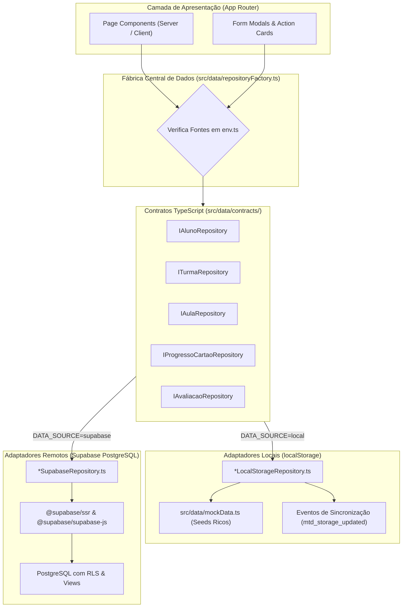
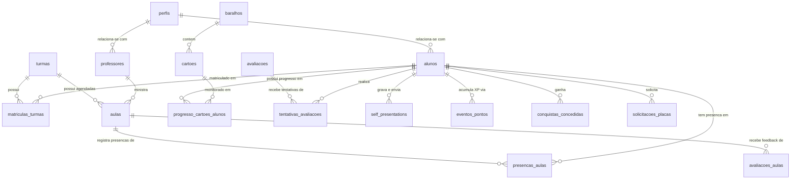
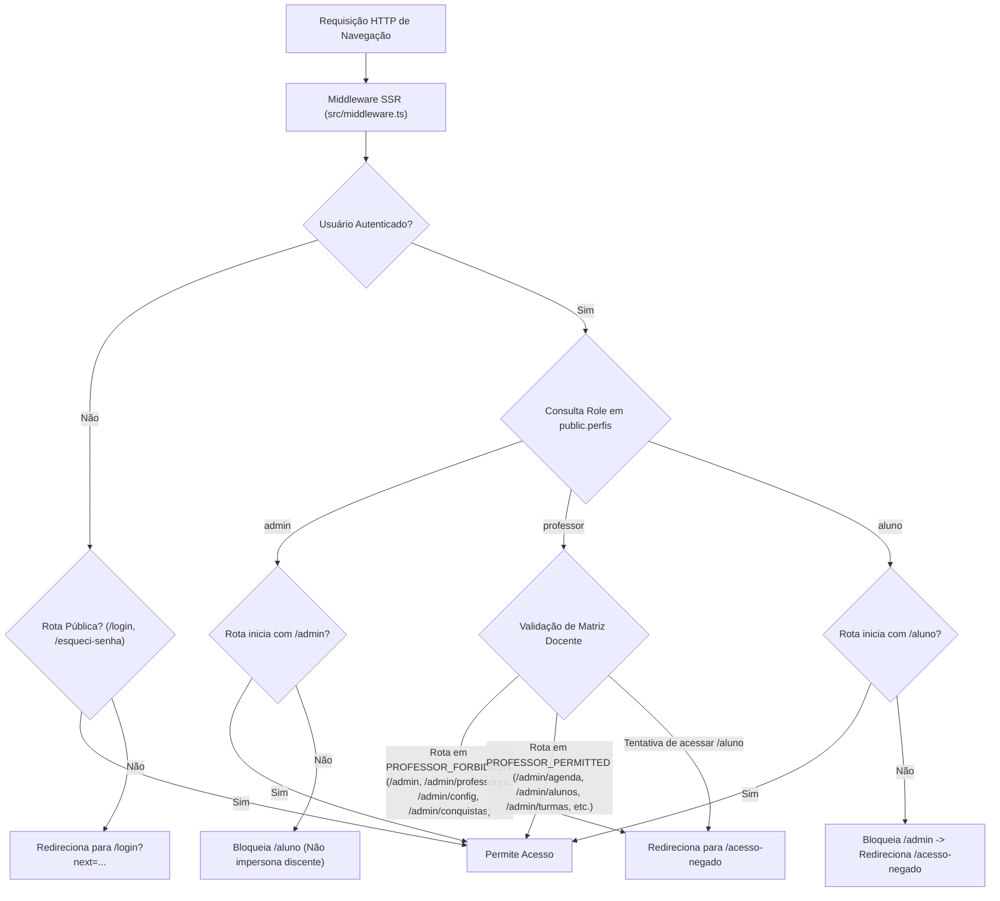
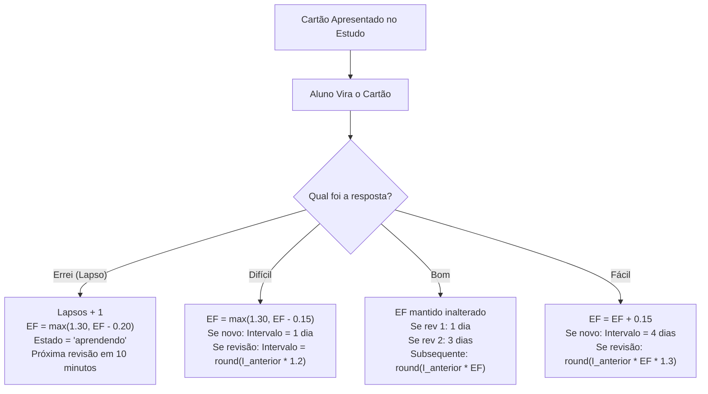
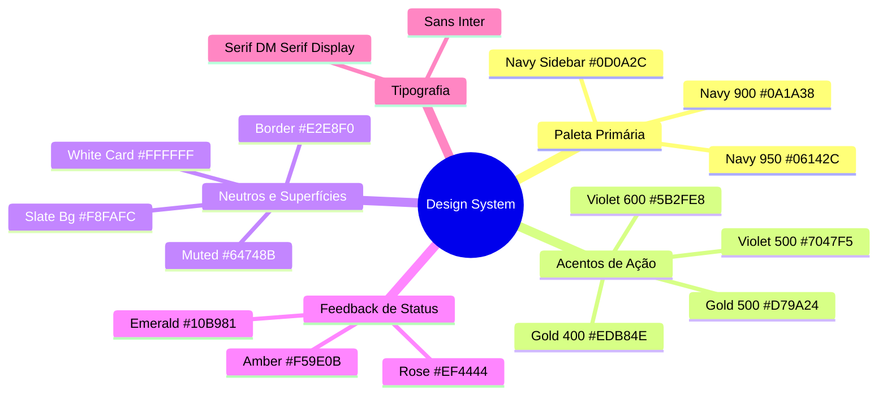
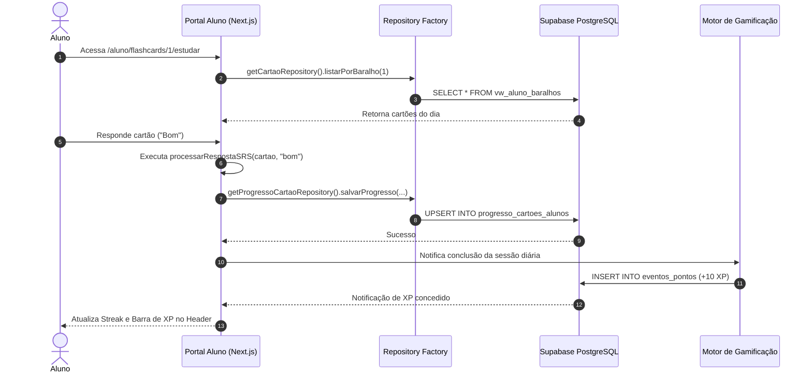
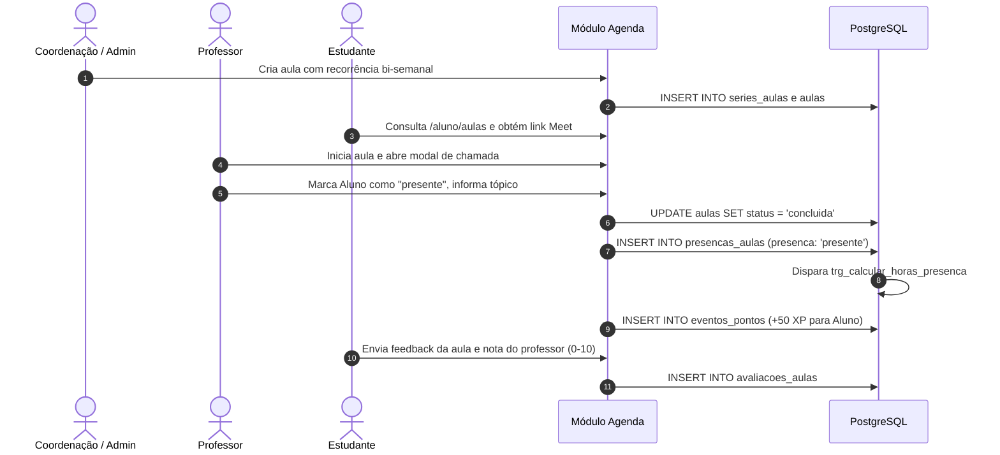
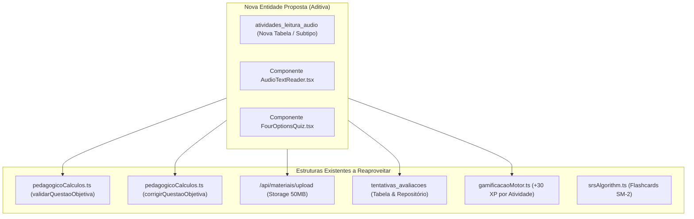

# INSTRUÇÕES DE CONTEXTO PARA O CHATGPT

> [!IMPORTANT]
> **ESTE DOCUMENTO É A FONTE PRIMÁRIA DE VERDADE DA PLATAFORMA MTD / JUNO ACADEMY.**
> Ele foi elaborado por um Engenheiro de Software Sênior e Arquiteto de Sistemas através de auditoria estática rigorosa do código-fonte, das 29 migrações SQL, dos 39 esquemas de banco de dados, das rotas e das regras de negócio do repositório.
> 
> Se você é uma instância do ChatGPT encarregada de continuar o desenvolvimento, planejar novas funcionalidades ou redigir prompts para o Antigravity, **leia e obedeça rigorosamente aos princípios abaixo antes de sugerir qualquer alteração**.

---

### Princípios Mandatórios para a Próxima IA (ChatGPT / Engenheiro)

1. **Preservação Absoluta das Funcionalidades Existentes**:
   - A plataforma possui módulos complexos e interconectados em produção: Gestão Acadêmica, Agenda com Recorrência e Reposição, Avaliações e Provas Objetivas/Práticas, Flashcards com SRS (SM-2), Self-Presentation em Vídeo, Materiais Didáticos com Upload de Mídia, Comunidade com Reações e Oportunidades, Gamificação (XP, Streaks, Conquistas e Placas com Hash de Validação), PWA completo e Internacionalização em 6 idiomas (`pt`, `en`, `es`, `fr`, `it`, `zh`).
   - NUNCA reescreva nem destrua um módulo existente para acomodar uma nova funcionalidade. Todas as extensões devem ser aditivas e compatíveis com a arquitetura vigente.

2. **Verificação Prévia de Existência (Não Reinvente a Roda)**:
   - Antes de projetar qualquer recurso, consulte a **Seção 16** e a **Seção 20** deste documento.
   - O motor de correção de questões objetivas já existe (`src/data/pedagogicoCalculos.ts`).
   - A validação de questões de 2 a 6 alternativas (incluindo 4 alternativas) já existe (`validarQuestaoObjetiva`).
   - O upload de mídias de até 50MB no Supabase Storage já está homologado (`src/app/api/materiais/upload/route.ts`).
   - O algoritmo de repetição espaçada com 4 botões já está implementado e testado (`src/data/srsAlgorithm.ts`).

3. **Respeito à Arquitetura Isomórfica de Repositórios (Dual-Layer)**:
   - O sistema opera sob um padrão de Repositórios Isomórficos coordenados por contratos TypeScript (`src/data/contracts/repositoryContracts.ts`) e resolvidos dinamicamente pela fábrica central (`src/data/repositoryFactory.ts`).
   - Cada entidade possui dois adaptadores concretos: `*LocalStorageRepository.ts` (para `APP_MODE=demo` e testes isolados no navegador) e `*SupabaseRepository.ts` (para `APP_MODE=production` conectado ao PostgreSQL com RLS).
   - Ao adicionar novas entidades ou novos métodos a repositórios existentes, você DEVE atualizar o contrato na interface correspondente e implementar a lógica em ambos os adaptadores, mantendo a tipagem estrita no TypeScript.

4. **Inviolabilidade das Regras Pedagógicas do Método Paulo**:
   - **Progressão de Nível CEFR (A1 a C2)**: É estritamente humana e pedagógica, oficializada pela coordenação docente. NUNCA automatize a mudança de nível de um discente com base em acúmulo de pontos, streaks ou horas assistidas.
   - **Cálculo de Horas de Aulas Assistidas**: Apenas presenças marcadas como `presente` em aulas com status `concluida` somam minutos (`duracaoMinutos`). Faltas (`ausente`), faltas justificadas (`justificado`), aulas canceladas e presenças não registradas geram rigorosamente **0 minutos**.
   - **Fórmula de Avaliação Objetiva**: Nota proporcional calculada estritamente como `(somaPontosObtidos / somaPontosTotais) * notaMaxima`, arredondada para duas casas decimais sem truncamento.

5. **Segurança, RLS e Isolamento Multi-tenant / Multi-perfil**:
   - O banco PostgreSQL adota o princípio de **Negação Padrão (Default Deny)** em todas as 39 tabelas via `ALTER TABLE ... ENABLE ROW LEVEL SECURITY`.
   - Alunos só podem ler seus próprios dados através de `auth.uid() = perfil_id` ou via Security Barrier Views (`vw_aluno_*`).
   - A `SUPABASE_SECRET_KEY` (service role) é estritamente de uso no servidor (Next.js Server Components, Server Actions ou Route Handlers) e NUNCA pode vazar para o navegador (`"server-only"`).

6. **Formatação de Prompts para o Antigravity**:
   - Ao instruir o agente Antigravity a executar alterações no código, forneça o caminho exato dos arquivos, mencione os contratos de interface a serem respeitados, exija testes estáticos com `npm run build` e indique a necessidade de validar o comportamento em ambos os modos (`demo` e `production`).

---

# 1. RESUMO EXECUTIVO DO SISTEMA

A **Juno Academy** (anteriormente identificada como *DEMOSTRATIVO MTD — Método Paulo*) é uma plataforma educacional de ensino de idiomas (LMS - Learning Management System / SaaS) arquitetada para atender três perfis de usuários com jornadas altamente especializadas:

1. **Administrador / Coordenação**: Gestão acadêmica integral, acompanhamento de matrículas, alocação de docentes, agenda de aulas com recorrência e reposições, materiais didáticos, matriz de avaliações, monitoramento de pendências, governança da comunidade e auditoria de pedidos de placas físicas e digitais de conquistas.
2. **Professor / Corpo Docente**: Painel focado em execução pedagógica. O professor acessa a agenda de aulas, realiza chamadas em tempo real com tópicos ministrados, cadastra turmas e materiais, elabora e corrige avaliações práticas via rubricas analíticas, revisa vídeos de *Self-Presentation* com notas e feedbacks detalhados, e consulta o **Background do Aluno** (dados biográficos, histórico profissional, interesses e objetivos). O acesso a áreas executivas financeiras, de RH ou configurações globais é bloqueado por RBAC.
3. **Aluno / Discente**: Experiência de aprendizagem imersiva e gamificada. O aluno consulta suas aulas agendadas e links de videoconferência (Google Meet / Zoom), visualiza seus colegas de turma, realiza sessões de estudos com Flashcards via algoritmo SRS (SM-2), envia vídeos de nivelamento (*Self-Presentation*), responde a avaliações e exercícios, submete tarefas, consome materiais didáticos, interage na comunidade de alunos e acompanha sua jornada de proficiência (CEFR A1 a C2), horas de presença acumuladas, sequência de estudos diária (*streaks*), XP e certificados/placas de reconhecimento.

### Estado Global de Prontidão

| Dimensão | Estado Atual | Evidência |
|---|---|---|
| **Frontend & UI** | 100% Funcional e Homologado | Next.js 14 App Router, Tailwind CSS, Lucide Icons, Totalmente Responsivo (Desktop, Notebook, Tablet, Mobile) |
| **Internacionalização (i18n)** | 100% Funcional (6 Idiomas) | `LanguageContext.tsx`, `translations.ts`, `dynamicTranslator.tsx` (`pt`, `en`, `es`, `fr`, `it`, `zh`) |
| **PWA & Offline Readiness** | 100% Funcional | `manifest.webmanifest`, `PwaRegister.tsx`, `sw.js` com cache v2 e brasão oficial em alta resolução |
| **Camada de Repositórios** | 100% Coberta (Dual-Layer) | 21 contratos e 42 adaptadores (`*LocalStorage` e `*Supabase`) com chaveamento granular em `env.ts` |
| **Banco de Dados PostgreSQL** | 100% Estruturado (29 Migrações) | 39 tabelas relacionais, 9 views de segurança, 88 funções/triggers, RLS Default Deny |
| **Autenticação & RBAC** | 100% Homologado | Supabase Auth PKCE + Middleware SSR + RBAC com 3 perfis e isolamento estrito de rotas |
| **Modo de Operação Atual** | Híbrido Isomórfico | `APP_MODE=demo` por padrão no repositório; chaveável para `APP_MODE=production` com Supabase remoto |

---

# 2. STACK E ARQUITETURA

### 2.1 Identificação Tecnológica Detalhada

- **Nome da Aplicação**: Juno Academy (marca comercial e visual) / Plataforma MTD (Método Paulo - núcleo pedagógico).
- **Framework Principal**: **Next.js 14.2.15** utilizando **App Router** (`src/app`).
- **Linguagem**: **TypeScript 5.0+** com configuração estrita (`"strict": true`, `"noImplicitAny": true`).
- **Biblioteca de Interface**: **React 18.3.1** (Server Components e Client Components estrategicamente separados).
- **Estilização**: **Tailwind CSS 3.4.1**, `tailwind-merge` 3.7.0, `clsx` 2.1.1.
- **Tipografia**: `DM Serif Display` (títulos e refinamento editorial) e `Inter` (corpo e interfaces) via `next/font/google`; `Geist Sans` e `Geist Mono` via `next/font/local`.
- **Ícones**: **Lucide React 1.59.0**.
- **Backend as a Service (BaaS)**: **Supabase** (PostgreSQL 15+, Supabase Auth com PKCE, Supabase Storage e Row Level Security).
- **Bibliotecas Supabase**: `@supabase/supabase-js` 2.109.0, `@supabase/ssr` 0.12.7, `server-only` 0.0.1.
- **Infraestrutura e Deploy**: **Vercel** (Edge Network e Serverless Functions). Produção: `https://demonstrativo-mtd.vercel.app`.
- **Branch Git e Versão**: Branch `main`. Commit local mais recente verificado: `3ba2d63` (`feat(pwa): use official method gold crest logo for PWA launcher and cache v2`).

### 2.2 Padrão Arquitetural: Dual-Layer Repository Pattern

O projeto resolve o desafio de permitir demonstrações completas e imediatas no navegador (sem necessidade de backend ativo) e, simultaneamente, operar como um SaaS corporativo seguro conectado ao Supabase.



### 2.3 Variáveis de Ambiente e Chaveamento Granular

As configurações de execução são geridas estritamente por `src/lib/env.ts`. Não há hardcode de credenciais.

| Variável | Tipo | Finalidade e Valores Permitidos |
|---|---|---|
| `APP_MODE` | Server | `'demo'` (dados mock/localStorage) ou `'production'` (produção) |
| `AUTH_MODE` | Server | `'demo'` (login aberto sem senha) ou `'supabase'` (Supabase Auth com PKCE) |
| `DATA_SOURCE` | Server | `'local'` ou `'supabase'` (fonte global padrão de dados) |
| `CORE_USERS_DATA_SOURCE` | Server/Client | `'local'` ou `'supabase'` (chaveamento específico de Alunos e Professores) |
| `ACADEMIC_CORE_DATA_SOURCE` | Server/Client | `'local'` ou `'supabase'` (chaveamento de Turmas e Matrículas) |
| `ACADEMIC_AGENDA_DATA_SOURCE` | Server/Client | `'local'` ou `'supabase'` (chaveamento de Aulas, Agenda e Presenças) |
| `ACADEMIC_CONTENT_DATA_SOURCE` | Server/Client | `'local'` ou `'supabase'` (chaveamento de Materiais e Atividades) |
| `ACADEMIC_EVALUATIONS_DATA_SOURCE` | Server/Client | `'local'` ou `'supabase'` (chaveamento de Avaliações e Tentativas) |
| `ACADEMIC_FLASHCARDS_DATA_SOURCE` | Server/Client | `'local'` ou `'supabase'` (chaveamento de Baralhos, Cartões e SRS) |
| `ACADEMIC_SELF_PRESENTATION_DATA_SOURCE` | Server/Client | `'local'` ou `'supabase'` (chaveamento de Self-Presentation e Vídeos) |
| `COMMUNITY_DATA_SOURCE` | Server/Client | `'local'` ou `'supabase'` (chaveamento de Comunidade e Feed) |
| `GAMIFICATION_DATA_SOURCE` | Server/Client | `'local'` ou `'supabase'` (chaveamento de Conquistas, Placas e Pontos) |
| `NEXT_PUBLIC_SUPABASE_URL` | Client/Server | URL do projeto Supabase (`https://[id].supabase.co`) |
| `NEXT_PUBLIC_SUPABASE_PUBLISHABLE_KEY` | Client/Server | Chave pública anônima padrão oficial (`sb_pub_...` ou `anon_key`) |
| `SUPABASE_SECRET_KEY` | Server-Only | Chave administrativa privada (`sb_sec_...` ou `service_role_key`). NUNCA exposta |

---

# 3. ESTRUTURA DO PROJETO

O repositório adota a estrutura padrão do Next.js 14 com separação limpa de responsabilidades:

```
demonstrativo-mtd/
├── docs/                                  # Documentações técnicas e guias operacionais
│   ├── MTD_CONTEXT_AUDIT_FOR_CHATGPT.md  # ESTE DOCUMENTO (Auditoria integral)
│   ├── SUPABASE_SETUP.md                  # Guia de implantação do banco
│   ├── SEGURANCA_BACKEND.md               # Especificação de RLS e auditoria
│   ├── PLANO_MIGRACAO_REPOSITORIOS.md    # Estratégia de migração incremental
│   └── ETAPA_10_BASELINE.md               # Baseline da arquitetura de backend
├── public/                                # Ativos estáticos públicos
│   ├── favicon.ico
│   ├── manifest.json / manifest.webmanifest # Manifesto PWA
│   ├── sw.js                              # Service Worker com cache v2
│   ├── logo-mtd.png                       # Logotipo oficial Juno Academy
│   └── icons/                             # Ícones PWA em múltiplas resoluções
├── scripts/                               # Mais de 40 scripts de testes E2E e validação
│   ├── test-agendamento-reposicao-recorrente-e2e.mjs
│   ├── test-aluno-background-e2e.mjs
│   ├── test-avaliacao-aula-e2e.mjs
│   ├── test-exclusao-admin-permissao-total.mjs
│   ├── test-etapa10-4c-flashcards.ts
│   └── ...
├── src/
│   ├── app/                               # Rotas da aplicação (App Router)
│   │   ├── admin/                         # Rotas administrativas e de professores
│   │   ├── aluno/                         # Rotas do portal discente
│   │   ├── api/                           # Route Handlers (Upload, Tradução, Auth)
│   │   ├── login/                         # Autenticação
│   │   ├── esqueci-senha/                 # Recuperação de senha
│   │   ├── redefinir-senha/               # Redefinição de senha com token
│   │   ├── acesso-negado/                 # Tela de fallback de RBAC
│   │   ├── layout.tsx                     # Root Layout com i18n e PWA
│   │   └── globals.css                    # Estilos globais e tokens Tailwind
│   ├── components/                        # Componentes React reutilizáveis
│   │   ├── admin/                         # Cards, modais e tabelas do Admin
│   │   ├── aluno/                         # Cards, jornadas e modais do Aluno
│   │   ├── common/                        # Badges, alertas, modais de confirmação
│   │   ├── navigation/                    # Sidebar, Header e menus responsivos
│   │   └── pwa/                           # Registro de Service Worker e banner PWA
│   ├── data/                              # Camada de Dados e Regras de Negócio
│   │   ├── contracts/                     # Interfaces TypeScript (repositoryContracts.ts)
│   │   ├── mockData.ts                    # Sementes completas para modo demo
│   │   ├── repositoryFactory.ts           # Resolução de adaptadores locais vs Supabase
│   │   ├── srsAlgorithm.ts                # Motor matemático de Repetição Espaçada (SM-2)
│   │   ├── pedagogicoCalculos.ts          # Correção objetiva, rubricas e conclusão de módulos
│   │   ├── gamificacaoMotor.ts            # Tabela de XP, horas de presença, streaks e placas
│   │   ├── validators.ts                  # Validações estritas de domínio
│   │   └── *LocalStorageRepository.ts     # 21 implementações com browser storage
│   │   └── *SupabaseRepository.ts         # 21 implementações com Supabase PostgreSQL
│   ├── lib/                               # Utilitários, contextos e infraestrutura
│   │   ├── auth/                          # Sessão, permissões RBAC e tokens
│   │   ├── i18n/                          # Suporte multilíngue (6 idiomas) e tradutor
│   │   ├── supabase/                      # Clientes client, server, admin e middleware
│   │   └── env.ts                         # Leitura segura de variáveis de ambiente
│   └── types/                             # Declarações centrais de tipos (index.ts)
├── supabase/
│   ├── migrations/                        # 29 arquivos SQL de migração sequencial
│   └── tests/                             # Scripts SQL de teste de RLS e integridade
├── package.json                           # Dependências e scripts de execução
├── tailwind.config.ts                     # Configuração de design tokens e paleta
└── tsconfig.json                          # Configurações do compilador TypeScript
```

---

# 4. MAPEAMENTO COMPLETO DE TELAS E ROTAS

A aplicação conta com **44 rotas de páginas (`page.tsx`)** mapeadas e ativas.

### 4.1 Área Administrativa e Docente (`/admin/*`)

| Rota | Objetivo da Tela | Perfis Autorizados | Fonte de Dados | Status |
|---|---|---|---|---|
| `/admin` | Dashboard executivo com métricas globais, KPIs de faturamento/horas e pendências gerais | Apenas `admin` | `api.ts` / `repositoryFactory` | **FUNCIONAL** |
| `/admin/alunos` | Listagem de discentes com filtros, status, nível CEFR, botão de novo cadastro e background | `admin`, `professor` | `alunoRepository` | **FUNCIONAL** |
| `/admin/alunos/[id]` | Perfil detalhado do discente com turmas, histórico de presença, avaliações, background traduzível | `admin`, `professor` | `alunoRepository`, `turmaRepository` | **FUNCIONAL** |
| `/admin/professores` | Gestão de docentes, carga horária, múltiplos telefones e status de contratação | Apenas `admin` | `professorRepository` | **FUNCIONAL** |
| `/admin/professores/[id]` | Prontuário do professor, turmas sob responsabilidade e agenda docente | Apenas `admin` | `professorRepository` | **FUNCIONAL** |
| `/admin/turmas` | Listagem de turmas com modalidade (individual/grupo), vagas, múltiplos professores e alunos | `admin`, `professor` | `turmaRepository` | **FUNCIONAL** |
| `/admin/turmas/[id]` | Detalhe da turma, matriculados, lista de alunos visível, professores vinculados e histórico | `admin`, `professor` | `turmaRepository` | **FUNCIONAL** |
| `/admin/agenda` | Calendário e agendamento de aulas com suporte a reposição, bi-semanal e chamada | `admin`, `professor` | `aulaRepository`, `presencaRepository` | **FUNCIONAL** |
| `/admin/materiais` | Catálogo de materiais didáticos (PDF, áudio, links, vocabulário) com upload de até 50MB | `admin`, `professor` | `materialRepository`, Storage | **FUNCIONAL** |
| `/admin/materiais/[id]` | Detalhe do material didático, download de anexos e estatísticas de uso | `admin`, `professor` | `materialRepository` | **FUNCIONAL** |
| `/admin/avaliacoes` | Gestão de avaliações objetivas (múltipla escolha) e práticas com rubricas analíticas | `admin`, `professor` | `avaliacaoRepository` | **FUNCIONAL** |
| `/admin/avaliacoes/[id]` | Criação e edição de questões, gabaritos, pontuações e histórico de tentativas de alunos | `admin`, `professor` | `avaliacaoRepository`, `tentativaRepository` | **FUNCIONAL** |
| `/admin/flashcards` | Gestão de baralhos de flashcards por nível e tema pedagógico | `admin`, `professor` | `baralhoRepository` | **FUNCIONAL** |
| `/admin/flashcards/[id]` | Cadastro de cartões (frente, verso, pronúncia, exemplos, tradução) | `admin`, `professor` | `cartaoRepository` | **FUNCIONAL** |
| `/admin/self-presentation` | Painel de revisão de vídeos de nivelamento e apresentações dos alunos | `admin`, `professor` | `selfPresentationRepository` | **FUNCIONAL** |
| `/admin/self-presentation/[id]` | Reprodutor de vídeo, preenchimento de rubrica de 0 a 10 e atribuição de nota/feedback | `admin`, `professor` | `selfPresentationRepository` | **FUNCIONAL** |
| `/admin/comunidade` | Moderação de postagens, canais temáticos e oportunidades profissionais | `admin`, `professor` | `comunidadeRepository` | **FUNCIONAL** |
| `/admin/comunidade/[id]` | Moderação detalhada de tópico e comentários específicos | `admin`, `professor` | `comunidadeRepository` | **FUNCIONAL** |
| `/admin/conquistas` | Gestão de modelos de conquistas, placas físicas/digitais e aprovação de envios | Apenas `admin` | `gamificacaoRepository` | **FUNCIONAL** |
| `/admin/conquistas/[id]` | Auditoria de pedido de placa com verificação de código hash antifraude | Apenas `admin` | `gamificacaoRepository` | **FUNCIONAL** |
| `/admin/configuracoes` | Parâmetros da escola, isolamento de ambiente, dados institucionais e PWA | Apenas `admin` | `localStorage` / Supabase | **FUNCIONAL** |

### 4.2 Área do Aluno (`/aluno/*`)

| Rota | Objetivo da Tela | Fonte de Dados | Status |
|---|---|---|---|
| `/aluno` | Dashboard discente com próximas aulas, link Meet/Zoom, streak, XP e atalhos rápidos | `repositoryFactory`, `session.ts` | **FUNCIONAL** |
| `/aluno/jornada` | Linha do tempo de proficiência CEFR (A1 a C2), módulos pedagógicos e status de conclusão | `moduloRepository`, `progressoModulo` | **FUNCIONAL** |
| `/aluno/aulas` | Histórico de aulas, presenças confirmadas, gravação e avaliação de aula e professor (0 a 10) | `aulaRepository`, `avaliacaoAulaRepository` | **FUNCIONAL** |
| `/aluno/materiais` | Biblioteca de materiais didáticos disponíveis para o nível da turma do aluno | `materialRepository` | **FUNCIONAL** |
| `/aluno/materiais/[id]` | Visualizador de material, tocador de áudio e leitor de documento integrado | `materialRepository` | **FUNCIONAL** |
| `/aluno/atividades` | Lista de tarefas práticas para entrega de texto/arquivo ao professor | `atividadeRepository`, `entregaRepository` | **FUNCIONAL** |
| `/aluno/avaliacoes` | Testes de nível e exames de proficiência disponíveis para realização | `avaliacaoRepository`, `tentativaRepository` | **FUNCIONAL** |
| `/aluno/avaliacoes/[id]` | Execução do exame objetivo (múltipla escolha) com cronômetro e correção imediata | `avaliacaoRepository`, `tentativaRepository` | **FUNCIONAL** |
| `/aluno/flashcards` | Lista de baralhos disponíveis para estudo diário | `baralhoRepository`, `progressoCartao` | **FUNCIONAL** |
| `/aluno/flashcards/[id]` | Visão geral do baralho com contagem de cartões novos, em revisão e dominados | `cartaoRepository`, `progressoCartao` | **FUNCIONAL** |
| `/aluno/flashcards/[id]/estudar` | Sessão interativa de repetição espaçada (frente/verso e botões Errei/Difícil/Bom/Fácil) | `srsAlgorithm.ts`, `progressoCartao` | **FUNCIONAL** |
| `/aluno/self-presentation` | Histórico de envios de vídeos de nivelamento e status da avaliação docente | `selfPresentationRepository` | **FUNCIONAL** |
| `/aluno/self-presentation/[id]` | Visualização de notas por rubrica, feedback do professor e transcrição | `selfPresentationRepository` | **FUNCIONAL** |
| `/aluno/comunidade` | Feed de publicações, dúvidas, oportunidades e interações sociais com reações | `comunidadeRepository` | **FUNCIONAL** |
| `/aluno/comunidade/[id]` | Leitura de postagem completa e adição de comentários | `comunidadeRepository` | **FUNCIONAL** |
| `/aluno/conquistas` | Galeria de badges conquistadas, placas digitais com selo e solicitação de placa física | `gamificacaoRepository` | **FUNCIONAL** |
| `/aluno/conquistas/[id]` | Certificado digital da conquista e modal para solicitar placa física | `gamificacaoRepository` | **FUNCIONAL** |
| `/aluno/perfil` | Dados cadastrais do aluno, preferências, objetivos e background | `alunoRepository`, `session.ts` | **FUNCIONAL** |

### 4.3 Rotas Públicas e de Autenticação

| Rota | Objetivo | Status |
|---|---|---|
| `/` | Redirecionador inteligente para o portal correspondente ao perfil logado | **FUNCIONAL** |
| `/login` | Tela de autenticação com e-mail/senha ou seletor de perfis no modo demo | **FUNCIONAL** |
| `/esqueci-senha` | Solicitação de link de recuperação de acesso via Supabase Auth | **FUNCIONAL** |
| `/redefinir-senha` | Atualização de credencial através do token de segurança PKCE | **FUNCIONAL** |
| `/acesso-negado` | Tela formal de bloqueio para tentativas de acesso não autorizadas | **FUNCIONAL** |

### 4.4 Endpoints de API (`src/app/api/**/route.ts`)

1. `POST /api/materiais/upload`: Upload de mídias para o bucket `materiais` no Supabase Storage. Valida tamanho máximo de 50MB e extensões permitidas (PDF, MP3, WAV, MP4, etc.).
2. `POST /api/translate`: Endpoint de tradução automática sob demanda para textos livres (biografia, interesses do aluno e dados pedagógicos).
3. `POST /api/auth/logout`: Revogação e limpeza segura de cookies de autenticação no servidor.
4. `POST /api/admin/alunos`: Criação administrativa de discentes no Supabase.
5. `POST /api/admin/professores`: Criação de professores com vínculo de identidade.
6. `POST /api/admin/acessos/convites`: Geração de convites seguros de ativação.
7. `POST /api/comunidade/comentarios`: Inserção autenticada de comentários.
8. `POST /api/comunidade/reacoes`: Toggle de curtidas e reações com proteção de concorrência.
9. `GET /api/env/*`: Endpoints de auditoria interna para inspeção do estado dos datasources.

---

# 5. BANCO DE DADOS E SUPABASE — PERSISTÊNCIA INTEGRAL

O banco de dados PostgreSQL do projeto conta com **29 migrações sequenciais** (`supabase/migrations/*.sql`), totalizando **39 tabelas relacionais**, **9 views de segurança** e **88 triggers/funções PL/pgSQL**.

### 5.1 Catálogo Completo de Tabelas



Abaixo está o inventário técnico de todas as 39 tabelas implementadas no banco:

| # | Tabela | Finalidade Pedagógica e Técnica | Principais Campos | Regras de Segurança (RLS) |
|---|---|---|---|---|
| 1 | `perfis` | Identidade de acesso unificada (espelho do `auth.users`) | `id (UUID)`, `email`, `role`, `status`, `nome_completo`, `avatar_url`, `aluno_id`, `professor_id` | Aluno lê próprio perfil; Admin lê e gerencia todos; Trigger bloqueia auto-promoção |
| 2 | `alunos` | Cadastro de estudantes e dados de matrícula | `id (UUID)`, `nome_completo`, `email`, `telefone`, `nivel_atual (CEFR)`, `status_matricula`, `data_nascimento`, `profissao`, `background` | Aluno lê apenas seus dados; Professores lêem alunos de suas turmas; Admin gerencia |
| 3 | `alunos_dados_pedagogicos` | Extensão cadastral de background e objetivos | `id`, `aluno_id`, `biografia`, `interesses`, `sobre_aluno`, `objetivo_ingles`, `historico_profissional` | Aluno e professores das suas turmas possuem leitura; Edição restrita a aluno/admin |
| 4 | `professores` | Cadastro do corpo docente e dados de contato | `id (UUID)`, `nome_completo`, `email`, `telefone`, `telefones_adicionais (JSONB)`, `status`, `bio`, `especialidades` | Leitura pública interna para usuários autenticados; Edição restrita ao Admin |
| 5 | `acessos_usuarios` | Controle do ciclo de vida de ativação e convites | `id`, `perfil_id`, `token_ativacao`, `status_acesso`, `expira_em` | Apenas Admin e Service Role possuem acesso. Totalmente blindada |
| 6 | `turmas` | Agrupamento de discentes por nível e horário | `id`, `nome`, `nivel (A1-C2)`, `modalidade (individual/grupo)`, `capacidade_maxima`, `professor_id`, `professores_adicionais (JSONB)` | Leitura para autenticados; Escrita restrita a Admin e docentes designados |
| 7 | `matriculas_turmas` | Vínculo entre alunos e turmas | `id`, `turma_id`, `aluno_id`, `status_matricula`, `data_matricula` | Aluno lê suas próprias matrículas; Admin/Professor gerenciam |
| 8 | `aulas` | Agenda de aulas ao vivo e sessões gravadas | `id`, `turma_id`, `professor_id`, `data_hora_inicio`, `duracao_minutos`, `status`, `link_meet`, `link_gravacao`, `tipo_aula` | Aluno lê apenas aulas de suas turmas; Professor lê e edita suas aulas; Admin controle total |
| 9 | `series_aulas` | Recorrência e padrões bi-semanais de aulas | `id`, `turma_id`, `dias_semana`, `horarios`, `data_inicio`, `data_fim` | Admin e professores das turmas |
| 10 | `presencas_aulas` | Registro de frequência e tópicos ministrados | `id`, `aula_id`, `aluno_id`, `presenca ('presente'/'ausente'/'justificado')`, `justificativa`, `observacao_pedagogica` | Aluno lê apenas suas presenças; Professor/Admin registram; Triggers impedem corrupção |
| 11 | `avaliacoes_aulas` | Feedback e nota da aula e do professor (0 a 10) | `id`, `aula_id`, `aluno_id`, `professor_id`, `nota_aula (0-10)`, `nota_professor (0-10)`, `comentario_aluno` | Aluno insere e lê as suas; Professor lê avaliações anônimas de suas aulas; Admin lê todas |
| 12 | `baralhos` | Decks de flashcards organizados por nível/tema | `id`, `titulo`, `descricao`, `nivel (CEFR)`, `categoria`, `total_cartoes`, `criado_por` | Leitura para autenticados do nível correspondente; Edição docente/admin |
| 13 | `cartoes` | Cartões individuais com dados de memorização | `id`, `baralho_id`, `frente`, `verso`, `exemplo_frase`, `audio_url`, `pronuncia_ipa`, `traducao_exemplo` | Leitura para alunos do baralho; Escrita para professores/admin |
| 14 | `progresso_cartoes_alunos` | Estado individual de cada cartão no SRS (SM-2) | `id`, `aluno_id`, `cartao_id`, `baralho_id`, `estado ('novo'/'aprendendo'/'revisao')`, `fator_facilidade`, `intervalo_dias`, `proxima_revisao`, `total_revisoes`, `total_lapsos` | Aluno possui acesso exclusivo ao seu próprio progresso (`auth.uid() = aluno_id`) |
| 15 | `historico_revisoes_srs` | Log de cada resposta dada no estudo de flashcards | `id`, `aluno_id`, `cartao_id`, `resposta ('errei'/'dificil'/'bom'/'facil')`, `data_hora`, `intervalo_anterior`, `novo_intervalo` | Aluno insere e consulta seu histórico; Admin audita |
| 16 | `sessoes_estudo_srs` | Registro de sessões de estudo finalizadas | `id`, `aluno_id`, `baralho_id`, `cartoes_estudados`, `tempo_segundos`, `data_sessao` | Aluno insere e visualiza; Alimenta motor de XP |
| 17 | `avaliacoes` | Exames formais (objetivos e práticos) | `id`, `titulo`, `tipo ('objetiva'/'pratica')`, `nivel`, `nota_maxima`, `questoes (JSONB)`, `rubrica (JSONB)`, `tempo_limite_minutos` | Leitura para alunos elegíveis; Criação/edição por docentes e coordenação |
| 18 | `tentativas_avaliacoes` | Resoluções e entregas de avaliações | `id`, `avaliacao_id`, `aluno_id`, `respostas_aluno (JSONB)`, `nota_final`, `aprovado (boolean)`, `feedback_docente`, `tempo_gasto_segundos` | Aluno submete e lê suas tentativas; Docente/Admin corrigem e avaliam |
| 19 | `atividades` | Tarefas e exercícios complementares | `id`, `titulo`, `descricao`, `tipo`, `turma_id`, `nivel`, `prazo_entrega`, `pontos_xp` | Alunos da turma/nível visualizam; Professores criam |
| 20 | `entregas_atividades` | Submissão de arquivos e textos de tarefas | `id`, `atividade_id`, `aluno_id`, `conteudo_texto`, `arquivo_url`, `status ('entregue'/'avaliado')`, `nota`, `feedback` | Aluno entrega a sua; Professor avalia e atribui nota |
| 21 | `materiais` | Acervo didático e mídias de apoio | `id`, `titulo`, `tipo ('pdf'/'audio'/'video'/'link')`, `url_arquivo`, `nivel`, `tamanho_bytes`, `tags` | Autenticados com acesso ao nível do material |
| 22 | `conteudos_diarios` | Micro-conteúdos diários de imersão | `id`, `titulo`, `data_publicacao`, `conteudo_html`, `audio_url`, `nivel` | Leitura liberada para alunos ativos |
| 23 | `self_presentations` | Gravações de nivelamento e oratória discente | `id`, `aluno_id`, `titulo`, `tipo_apresentacao`, `link_video`, `observacao_aluno`, `status ('pendente'/'avaliado')`, `nota_final`, `rubricas_avaliacao (JSONB)`, `feedback_docente`, `consentimento_uso` | Aluno envia a sua e lê o resultado; Professores e Admin corrigem |
| 24 | `espacos_comunidade` | Categorias e fóruns temáticos da comunidade | `id`, `nome`, `descricao`, `icone`, `ordem_exibicao` | Leitura para todos os autenticados; Admin cria/edita |
| 25 | `publicacoes_comunidade` | Postagens de alunos e professores no feed | `id`, `espaco_id`, `autor_perfil_id`, `titulo`, `conteudo`, `anexos (JSONB)`, `total_curtidas`, `total_comentarios` | Leitura pública autenticada; Autor edita a sua; Moderação por Admin |
| 26 | `comentarios_comunidade` | Respostas em postagens da comunidade | `id`, `publicacao_id`, `autor_perfil_id`, `conteudo`, `data_criacao` | Leitura para autenticados; Autor insere |
| 27 | `denuncias_comunidade` | Denúncias de conteúdo impróprio | `id`, `publicacao_id`, `denunciante_id`, `motivo`, `status` | Aluno cria denúncia; Visualização e deliberação restrita a Admin |
| 28 | `oportunidades_comunidade` | Mural de vagas e networking internacional | `id`, `titulo`, `empresa`, `descricao`, `link_candidatura`, `nivel_ingles_minimo` | Leitura para autenticados; Admin gerencia |
| 29 | `interesses_oportunidades` | Manifestações de interesse de alunos em vagas | `id`, `oportunidade_id`, `aluno_id`, `data_manifestacao` | Aluno gerencia seu interesse; Admin audita |
| 30 | `modelos_conquistas` | Definição das regras de badges e placas | `id`, `chave`, `titulo`, `descricao`, `categoria`, `tipo_criterio ('horas_aulas'/'streak'/'nivel')`, `meta_valor`, `badge_url`, `placa_elegivel` | Leitura para todos; Escrita restrita a Admin |
| 31 | `conquistas_concedidas` | Badges e marcos desbloqueados pelo aluno | `id`, `aluno_id`, `modelo_id`, `data_conquista`, `notificado` | Aluno lê suas conquistas; Motor do sistema concede |
| 32 | `solicitacoes_placas` | Pedidos de placas físicas de formatura/nível | `id`, `aluno_id`, `marco_atingido`, `codigo_validacao_hash`, `status ('pendente'/'em_producao'/'enviado')`, `endereco_entrega (JSONB)`, `rastreio_correios` | Aluno solicita e acompanha; Admin gerencia produção e envio |
| 33 | `eventos_pontos` | Ledger auditável de concessão de XP | `id`, `aluno_id`, `tipo_acao`, `pontos`, `descricao`, `referencia_entidade_id`, `data_criacao` | Aluno lê seu extrato de pontos; Sistema insere via transação segura |
| 34 | `notificacoes_sistema` | Alertas in-app para alunos e docentes | `id`, `destinatario_perfil_id`, `titulo`, `mensagem`, `lida (boolean)`, `link_acao` | Destinatário lê e marca como lida; Admin/Sistema geram |
| 35 | `auditoria_logs` | Trilha imutável de auditoria de operações | `id`, `operador_perfil_id`, `acao`, `entidade`, `entidade_id`, `payload_anterior (JSONB)`, `payload_novo (JSONB)`, `ip_address` | Imutável (triggers bloqueiam UPDATE e DELETE); Apenas Admin lê |
| 36 | `programas_pedagogicos` | Diretrizes dos cursos de idiomas | `id`, `nome`, `idioma`, `descricao_geral`, `ativo` | Leitura para autenticados; Gestão por Admin |
| 37 | `etapas_pedagogicas` | Etapas sequenciais dentro de um programa | `id`, `programa_id`, `nome_etapa`, `ordem` | Leitura para autenticados; Gestão por Admin |
| 38 | `modulos_pedagogicos` | Módulos de conteúdo dentro de cada nível | `id`, `etapa_id`, `nivel (CEFR)`, `titulo`, `descricao`, `carga_horaria_estimada` | Leitura para autenticados; Gestão por Admin |
| 39 | `progresso_modulos_alunos`| Acompanhamento da conclusão de módulos | `id`, `aluno_id`, `modulo_id`, `status ('em_andamento'/'concluido')`, `data_conclusao`, `validado_por_professor_id` | Aluno lê o seu progresso; Professor valida conclusão |

### 5.2 Views de Segurança (`SECURITY BARRIER`)

O banco utiliza 9 views projetadas com a cláusula `WITH (security_barrier = true)` para garantir que discentes consultem dados agregados sem risco de bypass via filtros WHERE com funções customizadas:

1. `vw_aluno_aulas`: Expõe apenas aulas das turmas em que o aluno autenticado possui matrícula ativa.
2. `vw_aluno_presencas`: Retorna a frequência do aluno, calculando faltas e presenças sem expor os registros dos demais colegas.
3. `vw_aluno_materiais`: Apresenta materiais pedagógicos filtrados pelo nível CEFR e turma do estudante.
4. `vw_aluno_avaliacoes`: Filtra avaliações disponíveis para o estudante realizar.
5. `vw_aluno_baralhos`: Lista baralhos vinculados ao nível do aluno.
6. `vw_aluno_atividades`: Lista tarefas práticas atribuídas às turmas do estudante.
7. `vw_aluno_self_presentations`: Retorna gravações e pareceres docentes vinculados exclusivamente ao `auth.uid()`.
8. `materiais_didaticos`: View de abstração para consumo padronizado do acervo.
9. `atividades_praticas`: View de unificação de tarefas e entregas discentes.

### 5.3 Triggers de Integridade Críticos

- `trg_protect_perfis_privileged_fields`: Impede que qualquer usuário não-administrador altere sua própria coluna `role` ou `status` na tabela `perfis`.
- `trg_auditoria_logs_immutable`: Bloqueia qualquer tentativa de `UPDATE` ou `DELETE` na tabela `auditoria_logs`. O log de auditoria é 100% append-only.
- `trg_calcular_horas_presenca`: Disparado ao atualizar `presencas_aulas` para manter integridade das estatísticas de frequência.
- `trg_exclusao_administrativa`: Implementado na migração `20261115000026_liberar_exclusao_agenda_admin.sql`, autoriza a exclusão em cascata de aulas e presenças históricas quando o operador possuir a role `admin`, resolvendo o bloqueio de rastreabilidade prévio sem abrir brechas para alunos ou professores.

---

# 6. AUTENTICAÇÃO E PERMISSÕES (RBAC)

### 6.1 Matriz de Controle de Acesso Baseada em Papéis (RBAC)

A segurança de acesso é governada pela matriz implementada em `src/lib/auth/permissions.ts` e executada em tempo real pelo middleware SSR (`src/lib/supabase/middleware.ts`):



### 6.2 Regras Estritas de Permissão Docente

O perfil `professor` possui restrições explícitas codificadas em `src/lib/auth/permissions.ts`:
- **Rotas Permitidas (`PROFESSOR_PERMITTED_ROUTES`)**:
  - `/admin/alunos` (visualização de fichas de alunos, progresso e background)
  - `/admin/turmas` (gestão das turmas onde leciona)
  - `/admin/agenda` (dashboard operacional padrão do professor, controle de aulas e chamadas)
  - `/admin/materiais` (compartilhamento de materiais pedagógicos)
  - `/admin/avaliacoes` (correção de testes e rubricas)
  - `/admin/self-presentation` (avaliação de vídeos de nivelamento)
  - `/admin/flashcards` (criação e revisão de baralhos didáticos)
  - `/admin/comunidade` (interação no fórum)
- **Rotas Proibidas (`PROFESSOR_FORBIDDEN_ROUTES`)**:
  - `/admin` (dashboard executivo e financeiro geral)
  - `/admin/professores` (gestão de RH e corpo docente)
  - `/admin/configuracoes` (configurações do sistema)
  - `/admin/conquistas` (motor de concessão e pedidos de placas físicas)

### 6.3 Resolução Estrita de Sessão e IDs Operacionais

Implementado em `src/lib/auth/session.ts`:
- Quando um usuário autentica, a sessão não carrega apenas o `user.id` do Supabase Auth.
- O sistema resolve os identificadores operacionais vinculados:
  - Se for discente: resolve `alunoId` consultando `alunos.id` associado ao perfil.
  - Se for professor: resolve `professorId` consultando `professores.id`.
- Isso garante que consultas e filtros de RLS e queries internas usem os IDs de domínio corretos, prevenindo conflitos entre o UUID do Auth e o UUID da entidade acadêmica.

---

# 7. SISTEMA PEDAGÓGICO — MÉTODO PAULO

O **Método Paulo (MTD)** estrutura a aquisição de proficiência em idiomas com base no Quadro Comum Europeu de Referência para Línguas (CEFR):

$$\text{Níveis CEFR}: \quad A1 \;\to\; A2 \;\to\; B1 \;\to\; B2 \;\to\; C1 \;\to\; C2$$

### 7.1 Regras de Progressão de Nível: Estritamente Humanas

> [!CAUTION]
> **REGRA DE NEGÓCIO INVIOLÁVEL DO MÉTODO PAULO**:
> A mudança de nível de um aluno (ex: de A2 para B1) **NUNCA é automática**.
> Nem horas assistidas, nem acúmulo de XP, nem sequências de flashcards promovem o aluno de nível.
> A progressão exige avaliação formal com rubrica docente, teste de nivelamento ou deliberação da coordenação pedagógica, que oficializa a alteração através da atualização de `alunos.nivel_atual`.

### 7.2 Background do Aluno e Contexto Pedagógico

Implementado nas migrações `20261115000028_adicionar_background_aluno.sql` e nos componentes de discentes:
- **Campos Estruturados**:
  - `idade`: Calculada ou informada.
  - `dataNascimento`: Data de nascimento do estudante.
  - `nivelEscolaridade`: Nível de formação acadêmica.
  - `profissao`: Área de atuação profissional do discente.
  - `nacionalidade`: País de origem.
  - `sobreAluno`: Descrição contextual do perfil.
  - `interesses`: Áreas de interesse (ex: negócios, viagens, tecnologia).
  - `biografia`: Histórico de estudos e experiência prévia com o idioma.
- **Visualização**: O card de Background fica visível para os professores dentro de `/admin/alunos/[id]`, auxiliando na personalização dos temas de conversação durante as aulas.
- **Tradução Dinâmica**: Possui alternador de tradução imediata (PT / EN) via `dynamicTranslator.tsx` e `backgroundTranslator.ts`, permitindo que professores internacionais consultem o background traduzido para inglês.

---

# 8. FLASHCARDS E ALGORITMO SRS — ANÁLISE PROFUNDA

A plataforma integra um sistema de repetição espaçada (Spaced Repetition System - SRS) baseado nos princípios matemáticos do **SuperMemo-2 (SM-2)**.

O código-fonte oficial e puro do algoritmo está localizado em:
[`src/data/srsAlgorithm.ts`](file:///Users/raypires/.gemini/antigravity/scratch/demonstrativo-mtd/src/data/srsAlgorithm.ts)

### 8.1 Constantes e Estados Fundamentais

- **Fator de Facilidade Padrão ($EF_{initial}$)**: `2.50`
- **Fator de Facilidade Mínimo ($EF_{min}$)**: `1.30`
- **Estados Possíveis de um Cartão (`EstadoCartaoAprendizagem`)**:
  1. `'novo'`: Cartão recém-cadastrado no baralho, nunca estudado pelo aluno ($totalRevisoes = 0, intervalo = 0$).
  2. `'aprendendo'`: Cartão que sofreu lapso de memória recente (o aluno escolheu a opção *Errei*).
  3. `'revisao'`: Cartão graduado em ciclo de retenção de longo prazo.

### 8.2 Comportamento Detalhado dos 4 Botões de Resposta

Quando um estudante revisa um cartão em `/aluno/flashcards/[id]/estudar`, o verso do cartão exibe 4 opções, cada qual acionando uma ramificação pura na função `processarRespostaSRS`:



#### A. Opção `"errei"`
- **Lapsos**: `totalLapsos = totalLapsos + 1`
- **Penalidade no Fator de Facilidade**: $EF_{novo} = \max(1.30, EF_{anterior} - 0.20)$
- **Novo Estado**: `'aprendendo'`
- **Intervalo em Dias**: `0`
- **Intervalo em Minutos**: `10 minutos`
- **Reagendamento**: `proximaRevisao = agora + 10 minutos`. O cartão é marcado com `reagendadoParaRevisao = true` e só reaparece quando o tempo decorrido atingir 10 minutos.

#### B. Opção `"dificil"`
- **Penalidade no Fator de Facilidade**: $EF_{novo} = \max(1.30, EF_{anterior} - 0.15)$
- **Novo Estado**: `'revisao'`
- **Cálculo do Próximo Intervalo**:
  - Se estado anterior era `'novo'` ou `'aprendendo'` ou $totalRevisoes = 0$: $I_{novo} = 1\text{ dia}$
  - Se já estava em revisão: $I_{novo} = \max(1, \text{round}(\max(1, I_{anterior}) \times 1.2))$

#### C. Opção `"bom"`
- **Fator de Facilidade**: Mantido inalterado ($EF_{novo} = EF_{anterior}$)
- **Novo Estado**: `'revisao'`
- **Cálculo do Próximo Intervalo**:
  - Se $totalRevisoes = 0$ (ou estado `'novo'`/`'aprendendo'`): $I_{novo} = 1\text{ dia}$
  - Se $totalRevisoes = 1$: $I_{novo} = 3\text{ dias}$
  - Para $totalRevisoes \ge 2$: $I_{novo} = \max(1, \text{round}(\max(1, I_{anterior}) \times EF_{novo}))$

#### D. Opção `"facil"`
- **Bônus no Fator de Facilidade**: $EF_{novo} = EF_{anterior} + 0.15$
- **Novo Estado**: `'revisao'`
- **Cálculo do Próximo Intervalo**:
  - Se estado anterior era `'novo'` ou `'aprendendo'` ou $totalRevisoes = 0$: $I_{novo} = 4\text{ dias}$
  - Para $totalRevisoes \ge 1$: $I_{novo} = \max(1, \text{round}(\max(1, I_{anterior}) \times EF_{novo} \times 1.3))$

### 8.3 Fila Diária e Cálculo de Vencimento

Um cartão torna-se elegível para estudo na data corrente se:
1. Seu estado for `'novo'`.
2. OU sua `proximaRevisao <= agoraIso` (cartão vencido ou agendado para o dia).

### 8.4 Registro de Histórico e Auditoria

A cada resposta, além do registro em `progresso_cartoes_alunos`, o sistema emite um registro imutável em `historico_revisoes_srs` contendo:
`alunoId`, `cartaoId`, `baralhoId`, `dataHora`, `resposta`, `estadoAnterior`, `intervaloAnterior`, `novoEstado`, `novoIntervalo`, `fatorAnterior`, `novoFator`.

---

# 9. AULAS AO VIVO, AGENDA E FREQUÊNCIA

O módulo de agenda e presença é gerenciado por `aulaRepository` e `presencaRepository`.

### 9.1 Fluxo Operacional de Aulas

1. **Agendamento**:
   - Criação por turma ou discente individual.
   - Suporte a **Aulas Recorrentes** (ex: Terças e Quintas) e **Aulas de Reposição** (`tipo_aula = 'reposicao'`).
   - Links de videoconferência: Validação estrita de URLs HTTPS (Google Meet ou Zoom).
2. **Realização e Chamada**:
   - O professor acessa a aula em `/admin/agenda` e abre a modal de chamada.
   - Marca cada aluno matriculado como:
     - `presente`
     - `ausente` (falta)
     - `justificado` (falta justificada)
   - O professor registra o tópico ministrado e observações pedagógicas.
   - Status da aula transiciona para `'concluida'`.
3. **Avaliação da Aula pelo Aluno (Feedback)**:
   - Implementado em `src/data/avaliacaoAulaRepository.ts` e migração `20261115000029_avaliacoes_aulas_professores.sql`.
   - O discente avalia a aula de 0 a 10 e avalia o professor de 0 a 10, podendo registrar comentários anônimos para a coordenação.

### 9.2 Regra Rigorosa de Cálculo de Horas Assistidas

Implementada na função pura `calcularHorasAulasPresenca` em `src/data/gamificacaoMotor.ts`:

$$\text{Total de Horas} = \frac{\sum \text{duracaoMinutos de aulas com status 'concluida' onde presenca} = \text{'presente'}}{60}$$

- **Faltas (`ausente`)**: Computam rigorosamente **0 minutos**.
- **Faltas Justificadas (`justificado`)**: Computam rigorosamente **0 minutos**.
- **Aulas Canceladas ou Pendentes**: Computam rigorosamente **0 minutos**.
- **Deduplicação Obrigatória**: Cada `aulaId` é processado estritamente uma única vez (`Set<string>()`).

---

# 10. AVALIAÇÕES, ATIVIDADES E EXERCÍCIOS

O sistema oferece infraestrutura para exames teóricos objetivos e práticos com rubricas.

### 10.1 Avaliações Objetivas (Múltipla Escolha)

O código em `src/data/pedagogicoCalculos.ts` implementa:
1. **Validação de Questões (`validarQuestaoObjetiva`)**:
   - Enunciado mínimo de 5 caracteres.
   - **Entre 2 e 6 alternativas** por questão (atendendo perfeitamente o padrão de 4 alternativas).
   - Proibição de alternativas vazias ou textos duplicados na mesma questão.
   - Obrigatoriedade de uma única alternativa correta vinculada a uma alternativa existente.
   - Pontuação numérica positiva maior que zero.
2. **Motor de Correção Automática (`corrigirQuestaoObjetiva`)**:
   - Compara a alternativa enviada pelo aluno com `alternativaCorretaId`.
   - Atribui integralmente os pontos da questão se correta, ou 0 se incorreta.
3. **Cálculo da Nota Final (`calcularNotaAvaliacaoObjetiva`)**:

$$\text{Nota Final} = \left( \frac{\sum \text{Pontos Obtidos}}{\sum \text{Pontos Totais da Prova}} \right) \times \text{Nota Máxima da Avaliação}$$

   - Arredondamento explícito para duas casas decimais (`Number((proporcao * notaMaxima).toFixed(2))`).
   - Fornece uma string explicativa detalhada da fórmula aplicada para transparência no boletim do estudante.

### 10.2 Avaliações Práticas com Rubrica Analítica

Para avaliações orais ou de escrita livre corrigidas por professores (`calcularNotaAvaliacaoPratica`):
- O professor avalia múltiplos critérios pedagógicos (ex: Pronúncia, Vocabulário, Coesão Gramatical, Fluência).
- Cada critério tem uma pontuação máxima definida.
- A nota final é proporcional:

$$\text{Nota Final Prática} = \left( \frac{\sum \text{Pontos Atribuídos nos Critérios}}{\sum \text{Pontos Máximos da Rubrica}} \right) \times \text{Nota Máxima}$$

### 10.3 Registro de Tentativas e Histórico

Persistido na tabela `tentativas_avaliacoes`:
- Registra as respostas do aluno em formato JSONB.
- Registra tempo de execução em segundos.
- Registra se o aluno atingiu a nota de corte para aprovação (`aprovado: boolean`).
- Garante histórico cumulativo de tentativas anteriores.

---

# 11. SELF-PRESENTATION E MÍDIAS

O módulo de **Self-Presentation** avalia a evolução na oratória e conversação em inglês do estudante.

### 11.1 Componentes e Fluxo

- **Envio Discente**: `src/components/aluno/SelfPresentationFormModal.tsx`.
  - O aluno informa o link HTTPS de seu vídeo gravado (YouTube, Google Drive, Vimeo, Loom ou link direto).
  - O discente é obrigado a assinar o termo de consentimento pedagógico (`TEXTO_CONSENTIMENTO_OFICIAL`, `VERSAO_CONSENTIMENTO_ATUAL`).
- **Avaliação Docente**: `src/app/admin/self-presentation/[id]/page.tsx`.
  - O professor assiste ao vídeo através de reprodutor embutido.
  - Avalia a apresentação utilizando uma rubrica pedagógica de 4 eixos (Pronúncia, Vocabulário, Estrutura Gramatical e Fluência).
  - Emite feedback qualitativo e nota de 0 a 10.
  - O status atualiza de `'pendente'` para `'avaliado'`.

### 11.2 Armazenamento de Arquivos no Supabase Storage

- **Endpoint de Upload**: `src/app/api/materiais/upload/route.ts`.
- **Bucket**: `materiais` (público para download dos discentes autenticados).
- **Limite de Tamanho**: **50 MB** por arquivo.
- **Tipos MIME Permitidos**: Áudio (`audio/mpeg`, `audio/wav`, `audio/aac`), Vídeo (`video/mp4`, `video/webm`), Documentos (`application/pdf`, `.docx`, `.pptx`, `.txt`), Imagens (`image/png`, `image/jpeg`).
- **Sanitização**: Remove acentuação e caracteres especiais dos nomes de arquivo, prefixando timestamp único para evitar sobreposição.

---

# 12. GAMIFICAÇÃO, XP, STREAKS E CONQUISTAS

O motor de gamificação pedagógica está em `src/data/gamificacaoMotor.ts`.

### 12.1 Tabela Oficial de Pontuação (XP)

| Evento Pedagógico (`TipoAcaoPontos`) | Pontos (XP) | Descrição Oficial no Ledger |
|---|---|---|
| `presenca_aula` / `aula_presenca` | **50 XP** | Presença em aula ao vivo confirmada pelo professor na chamada |
| `revisao_flashcards_diaria` | **10 XP** | Sessão diária de revisão de flashcards concluída |
| `manutencao_streak` | **20 XP** | Manutenção de sequência diária consecutiva de estudos |
| `conclusao_modulo` / `modulo_concluido` | **100 XP** | Conclusão e validação pedagógica de módulo curricular |
| `avaliacao_pratica_aprovada` | **150 XP** | Aprovação em avaliação prática com rubrica docente |
| `atividade_entregue` | **30 XP** | Atividade pedagógica ou exercício entregue no prazo |
| `marco_nivel_operacional` | **300 XP** | Marco de nível operacional oficializado pela coordenação |
| `conquista_especial` | **200 XP** | Reconhecimento de destaque pedagógico ou premiação especial |

### 12.2 Sequência de Estudos Diária (*Streak*)

Calculada pela função pura `calcularStreakFlashcards`:
- Coleta os dias únicos em formato `YYYY-MM-DD` com sessões de estudo finalizadas.
- Compara com a data atual (`hojeStr`) e a data anterior (`ontemStr`).
- Se o aluno não estudou nem hoje nem ontem, o streak é resetado para **0 dias**.
- Se estudou hoje ou ontem, realiza a contagem regressiva dia a dia sem interrupção.

### 12.3 Placas Físicas e Digitais com Hash Antifraude

Para cada conquista que confere direito a placa de formatura/nível:
- O sistema gera um código alfanumérico único através de hash determinístico:
  ```typescript
  gerarCodigoValidacaoPlaca(alunoId, marcoNome) // Ex: "MTD-PLK-8421-B2LV"
  ```
- O discente preenche endereço de entrega residencial no modal de solicitação.
- A coordenação audita em `/admin/conquistas/[id]` e atualiza o status (`pendente` $\to$ `em_producao` $\to$ `enviado` com código de rastreio dos Correios).

---

# 13. MATERIAIS E COMUNIDADE

### 13.1 Materiais Didáticos

- Repositório: `materialRepository` (implementado em `materialLocalStorageRepository.ts` e `materialSupabaseRepository.ts`).
- Suporta múltiplos formatos: PDFs de apostilas, áudios de *listening*, vídeos complementares e links de artigos.
- Organizados por nível de proficiência e tags temáticas.

### 13.2 Comunidade Discente

- Fórum estruturado por **Espaços Temáticos** (ex: Dúvidas de Gramática, Dicas Culturais, Oportunidades de Carreira, Networking).
- Publicações com texto, links e anexos.
- Sistema de **Reações e Curtidas** com proteção de concorrência (`/api/comunidade/reacoes`).
- Comentários e respostas encadeadas.
- Canal de denúncias para moderação da equipe pedagógica.

---

# 14. INTERFACE E DESIGN SYSTEM

### 14.1 Identidade Visual e Tokens

A plataforma adota estética visual sofisticada com alto contraste e acabamento profissional:



### 14.2 Componentes e Responsividade

- **Sidebar de Navegação**: Adapta dinamicamente os itens conforme o papel (`admin`, `professor`, `aluno`).
- **Header Global**: Inclui campo de busca rápida, alternador de idiomas (`I18nLanguageSelector`), notificações e perfil do usuário.
- **Responsividade Multi-device**: Homologada para resoluções Desktop (1920x1080, 1440x900), Notebook (1280x800), Tablet (768x1024) e Mobile (390x844).

---

# 15. FLUXOS ENTRE MÓDULOS

### 15.1 Ciclo de Estudo, Avaliação e Concessão de XP



### 15.2 Ciclo de Agendamento, Presença e Cômputo de Horas



---

# 16. PREPARAÇÃO PARA FUTURA IMPLEMENTAÇÃO DE EXERCÍCIOS

O usuário informou a intenção de expandir a plataforma educacional com exercícios interativos inspirados na experiência pedagógica do **Lingua.com**.

> [!IMPORTANT]
> **ESTA SEÇÃO É UM DIAGNÓSTICO TÉCNICO DE PRONTIDÃO E REAPROVEITAMENTO.**
> Não implemente nada agora. Utilize estas respostas para planejar a futura arquitetura.

### 16.1 Perguntas Objetivas da Auditoria

#### Pergunta 1: O sistema atualmente suporta exercícios com 4 alternativas?
**RESPOSTA: SIM, TOTALMENTE SUPORTADO.**
- **Comprovação**: No arquivo [`src/data/pedagogicoCalculos.ts`](file:///Users/raypires/.gemini/antigravity/scratch/demonstrativo-mtd/src/data/pedagogicoCalculos.ts#L276-L320), a função `validarQuestaoObjetiva` valida que cada questão possua entre 2 e 6 alternativas (`alts.length < 2 || alts.length > 6`). Uma questão com exatamente 4 alternativas (A, B, C, D) atende com precisão matemática a regra do validador. Além disso, o validador garante que nenhuma alternativa esteja vazia, que não existam textos repetidos e que uma única `alternativaCorretaId` válida esteja associada.

#### Pergunta 2: Já existe um motor de correção automática?
**RESPOSTA: SIM, TOTALMENTE IMPLEMENTADO E DETERMINÍSTICO.**
- **Comprovação**: Em [`src/data/pedagogicoCalculos.ts`](file:///Users/raypires/.gemini/antigravity/scratch/demonstrativo-mtd/src/data/pedagogicoCalculos.ts#L12-L87), as funções `corrigirQuestaoObjetiva` e `calcularNotaAvaliacaoObjetiva` executam a validação automática das respostas enviadas, confrontam com a alternativa correta cadastrada, somam os pontos e calculam a nota final proporcional à nota máxima da prova, gerando a fórmula explicativa por extenso.

#### Pergunta 3: Existe estrutura para textos com perguntas de interpretação?
**RESPOSTA: PARCIALMENTE SUPORTADO NA CAMADA DE DADOS; AUSENTE NO FRONTEND ESPECÍFICO.**
- **Comprovação**: O modelo de dados `Avaliacao` e a tabela `avaliacoes` no Supabase suportam enunciados longos e estruturas JSONB para instruções complementares. No entanto, **não existe ainda uma entidade ou tela de exercícios combinada** que renderize um texto de leitura (Reading) com formatação rica no topo ou à esquerda, e as perguntas de interpretação com 4 alternativas abaixo ou à direita.

#### Pergunta 4: Existe suporte para texto acompanhado de áudio (Listening / Reading)?
**RESPOSTA: ESTRUTURA DE MÍDIA EXISTE; FLUXO INTEGRADO DE EXERCÍCIO NÃO EXISTE.**
- **Comprovação**: O endpoint [`src/app/api/materiais/upload/route.ts`](file:///Users/raypires/.gemini/antigravity/scratch/demonstrativo-mtd/src/app/api/materiais/upload/route.ts) já está homologado e recebe arquivos de áudio (MP3, WAV, AAC) de até 50MB no Supabase Storage. O visualizador de materiais (`src/app/aluno/materiais/[id]/page.tsx`) possui tocador de áudio funcional. Contudo, **ainda não existe o componente que une o player de áudio sincronizado ao texto de leitura e ao bloco de questões de múltipla escolha**.

#### Pergunta 5: Como os resultados são armazenados?
**RESPOSTA**: São persistidos na tabela `tentativas_avaliacoes` (e no adaptador `tentativaAvaliacaoSupabaseRepository.ts` / `tentativaAvaliacaoLocalStorageRepository.ts`), que armazena o array de respostas do discente em JSONB, nota final calculada, status de aprovação, duração em segundos e data/hora.

### 16.2 Estratégia de Reutilização para Novos Exercícios

Para implementar o modelo Lingua.com sem quebrar a plataforma:



1. **Reaproveitamento de Flashcards**: O sistema de Flashcards existente (`srsAlgorithm.ts`) não precisará de qualquer modificação, bastando criar baralhos temáticos vinculados aos vocabulários dos textos lidos.
2. **Reaproveitamento de Motor de Correção**: O validador e corretor em `pedagogicoCalculos.ts` processará as 4 alternativas de cada pergunta de interpretação sem necessidade de novo código de correção.
3. **Reaproveitamento de Armazenamento**: O áudio narrado do texto será gravado no bucket `materiais` via `/api/materiais/upload`.
4. **Alimentação de Dashboards**: O resultado alimentará a tabela `eventos_pontos` (concedendo `+30 XP` sob o tipo `atividade_entregue`) e aparecerá no histórico acadêmico do aluno sem interferir na regra estrita de níveis CEFR.

---

# 17. INVENTÁRIO TÉCNICO DO ESTADO REAL DE DESENVOLVIMENTO

Classificação técnica baseada em inspeção minuciosa de código e migrações:

| Módulo | Funcionalidades | Status | Persistência | Evidência no Código | Pendências / Observações |
|---|---|---|---|---|---|
| **Autenticação & Sessão** | Login PKCE, Logout, Recuperação de Senha, RBAC (Admin, Professor, Aluno) | **FUNCIONAL** | Supabase Auth + `perfis` (ou Local) | `src/lib/auth/session.ts`, `permissions.ts`, `middleware.ts` | Homologado em ambos os modos. |
| **Alunos** | Cadastro, listagem, filtros, dados cadastrais e Background | **FUNCIONAL** | `alunos`, `alunos_dados_pedagogicos` | `alunoRepository.ts`, `alunoSupabaseRepository.ts` | 100% persistido. |
| **Background do Aluno** | Idade, Data Nasc, Escolaridade, Profissão, Bio, Interesses, Tradução PT/EN | **FUNCIONAL** | PostgreSQL / localStorage | `BackgroundAlunoCard.tsx`, `backgroundTranslator.ts` | Tradução dinâmica ativa. |
| **Professores** | Cadastro, múltiplos telefones, especialidades, status | **FUNCIONAL** | `professores` | `professorRepository.ts`, `professorSupabaseRepository.ts` | Rotas administrativas restritas a Admin. |
| **Turmas** | Vagas, nível, modalidade (individual/grupo), docentes vinculados | **FUNCIONAL** | `turmas`, `matriculas_turmas` | `turmaRepository.ts`, `turmaSupabaseRepository.ts` | Alunos visíveis na turma para conferência. |
| **Agenda & Aulas** | Agendamento bi-semanal, reposição, meet link, chamada, presença | **FUNCIONAL** | `aulas`, `series_aulas`, `presencas_aulas` | `aulaRepository.ts`, `presencaRepository.ts` | Exclusão administrativa em cascata liberada. |
| **Avaliação de Aulas** | Nota 0-10 da aula e do professor pelo discente com comentário | **FUNCIONAL** | `avaliacoes_aulas` | `avaliacaoAulaRepository.ts` | Conectado na visão discente pós-aula. |
| **Flashcards & SRS** | Baralhos, cartões, frente/verso, SM-2, 4 botões, lapsos, fila diária | **FUNCIONAL** | `baralhos`, `cartoes`, `progresso_cartoes_alunos`, `historico_revisoes_srs` | `srsAlgorithm.ts`, `progressoCartaoRepository.ts` | Algoritmo 100% determinístico e funcional. |
| **Avaliações Objetivas** | 2-6 alternativas (4 alternativas), validação, correção automática, notas | **FUNCIONAL** | `avaliacoes`, `tentativas_avaliacoes` | `pedagogicoCalculos.ts`, `avaliacaoRepository.ts` | Motor pronto para expansão Lingua.com. |
| **Avaliações Práticas** | Rubricas analíticas, correção docente critério a critério | **FUNCIONAL** | `avaliacoes`, `tentativas_avaliacoes` | `pedagogicoCalculos.ts`, `avaliacaoRepository.ts` | Interface de avaliação manual operando. |
| **Self-Presentation** | Envio de vídeo HTTPS, aceite de consentimento, rubrica docente, notas | **FUNCIONAL** | `self_presentations` | `selfPresentationRepository.ts` | Reprodutor de vídeo e histórico ativos. |
| **Upload de Mídias** | Upload de PDF, áudio, vídeo de até 50MB no Supabase Storage | **FUNCIONAL** | Bucket `materiais` no Supabase Storage | `src/app/api/materiais/upload/route.ts` | Suporta MP3, WAV, AAC, MP4, PDF. |
| **Gamificação** | Ledger de XP (+50, +10, +20, +100, +150, +30), streaks, conquistas | **FUNCIONAL** | `eventos_pontos`, `conquistas_concedidas` | `gamificacaoMotor.ts`, `gamificacaoRepository.ts` | Fórmulas estritas sem avanço automático de nível. |
| **Placas de Reconhecimento** | Solicitação física/digital, código de validação com hash, gestão de envio | **FUNCIONAL** | `solicitacoes_placas`, `modelos_conquistas` | `gamificacaoMotor.ts`, `solicitacoes_placas` | Fluxo completo do pedido ao rastreio. |
| **Comunidade** | Espaços, posts, comentários, reações (curtidas), denúncias, oportunidades | **FUNCIONAL** | `publicacoes_comunidade`, `comentarios_comunidade`, etc. | `comunidadeRepository.ts` | Toggle de reações com idempotência. |
| **PWA** | Service Worker v2, instalação offline, ícones com brasão oficial dourado | **FUNCIONAL** | Cache storage / Manifest | `manifest.webmanifest`, `sw.js`, `PwaRegister.tsx` | Validado e operando em produção. |
| **Internacionalização** | 6 idiomas (PT, EN, ES, FR, IT, ZH), alternador global no Header | **FUNCIONAL** | Contexto React / Dicionário | `LanguageContext.tsx`, `translations.ts` | Traduz textos estáticos e dinâmicos. |
| **Interpretação Texto + Áudio** | Interface tipo Lingua.com (texto + player + 4 alternativas) | **NÃO IMPLEMENTADO** | Planejado / Requisito | Apenas peças isoladas (upload áudio e quiz) | Requisito documentado na Seção 16. |

---

# 18. RISCOS, SEGURANÇA E PROBLEMAS IDENTIFICADOS

### 18.1 Análise Estática de Riscos

1. **Risco de Vazamento de Segredos Server-Side**:
   - *Diagnóstico*: O arquivo `src/lib/env.ts` utiliza `typeof window !== "undefined"` e lança exceção se `getServerEnv()` for chamado no cliente. O pacote `server-only` está configurado. A chave `SUPABASE_SECRET_KEY` não possui prefixo `NEXT_PUBLIC_` e não vaza para o bundle do navegador. Risco: **BAIXO / MITIGADO**.
2. **Risco de Bypass de RLS por Aluno**:
   - *Diagnóstico*: As políticas RLS foram validadas no script `supabase/tests/rls_validation.sql`. As views do aluno utilizam `security_barrier = true`. Alunos só acessam registros cujo `auth.uid()` coincida com o perfil correspondente. Risco: **BAIXO / CONTROLADO**.
3. **Risco de Concorrência em Reações e Curtidas**:
   - *Diagnóstico*: Corrigido na etapa anterior via endpoint transacional `/api/comunidade/reacoes`, evitando contadores dessincronizados. Risco: **MITIGADO**.
4. **Ausência de Runner Padronizado no `package.json`**:
   - *Diagnóstico*: O projeto possui mais de 40 scripts de testes em `scripts/*.mjs` e `scripts/*.ts`, mas o `package.json` possui apenas `"lint": "next lint"`, `"build": "next build"`, sem script unificado `"test": "..."`.
   - *Recomendação*: Ao rodar testes, execute os scripts diretamente com `node scripts/[nome-do-teste].mjs` ou `npx tsx scripts/[nome-do-teste].ts`.

---

# 19. RECOMENDAÇÕES TÉCNICAS E ORDEM PARA FUTURA IMPLEMENTAÇÃO

Caso o ChatGPT ou a equipe vá implementar o módulo de **Leitura com Áudio e Interpretação (Lingua.com)**, a ordem recomendada de menor risco para a estabilidade da aplicação é:

1. **Etapa 1 — Modelagem e Contratos**:
   - Não altere tabelas existentes de forma destrutiva.
   - Crie uma tabela `atividades_leitura_audio` ou adicione campos opcionais em `atividades` (`texto_conteudo TEXT`, `audio_url TEXT`, `questoes_interpretacao JSONB`).
   - Crie o contrato `IAtividadeLeituraRepository` estendendo a arquitetura atual.
2. **Etapa 2 — Adaptador de Dados Duplo**:
   - Implemente `atividadeLeituraLocalStorageRepository.ts` (com mocks no `mockData.ts`) e `atividadeLeituraSupabaseRepository.ts`.
   - Registre a entidade em `src/data/repositoryFactory.ts`.
3. **Etapa 3 — Componentes de Interface**:
   - Crie `AudioTextReader.tsx` para reprodução do áudio com texto destacado.
   - Reutilize `validarQuestaoObjetiva` e `corrigirQuestaoObjetiva` de `pedagogicoCalculos.ts` para renderizar o bloco de 4 alternativas.
4. **Etapa 4 — Gamificação**:
   - Conecte o evento de conclusão a `TABELA_PONTOS_PADRAO.atividade_entregue` (+30 XP) via `gamificacaoMotor.ts`.
   - NUNCA promova o nível CEFR do discente automaticamente.
5. **Etapa 5 — Testes e Validação Estática**:
   - Crie um script de teste em `scripts/test-leitura-audio-e2e.mjs`.
   - Valide a integridade do build com `npm run build`.

---

# 20. ÍNDICE DE ARQUIVOS IMPORTANTES

Abaixo está o inventário de arquivos essenciais da plataforma com seus caminhos absolutos e papéis no sistema:

### Camada de Negócio e Algoritmos (`src/data/`)
- [`src/data/srsAlgorithm.ts`](file:///Users/raypires/.gemini/antigravity/scratch/demonstrativo-mtd/src/data/srsAlgorithm.ts): Motor matemático de Repetição Espaçada SM-2 (fórmulas de 4 botões, fator de facilidade, lapsos).
- [`src/data/pedagogicoCalculos.ts`](file:///Users/raypires/.gemini/antigravity/scratch/demonstrativo-mtd/src/data/pedagogicoCalculos.ts): Validação de questões (2 a 6 alternativas), correção automática e rubricas práticas.
- [`src/data/gamificacaoMotor.ts`](file:///Users/raypires/.gemini/antigravity/scratch/demonstrativo-mtd/src/data/gamificacaoMotor.ts): Tabela oficial de XP, cálculo de horas de presença (0 min para faltas), streak e placas com hash.
- [`src/data/repositoryFactory.ts`](file:///Users/raypires/.gemini/antigravity/scratch/demonstrativo-mtd/src/data/repositoryFactory.ts): Fábrica central que chaveia entre LocalStorage e Supabase por domínio.
- [`src/data/contracts/repositoryContracts.ts`](file:///Users/raypires/.gemini/antigravity/scratch/demonstrativo-mtd/src/data/contracts/repositoryContracts.ts): Definições de contratos TypeScript de todos os repositórios.
- [`src/data/mockData.ts`](file:///Users/raypires/.gemini/antigravity/scratch/demonstrativo-mtd/src/data/mockData.ts): Sementes ricas de dados demonstrativos para operação no modo demo.
- [`src/data/validators.ts`](file:///Users/raypires/.gemini/antigravity/scratch/demonstrativo-mtd/src/data/validators.ts): Validadores de domínio (e-mail, CPF, URLs Meet/Zoom, consentimento).

### Autenticação, Segurança e Infraestrutura (`src/lib/`)
- [`src/lib/env.ts`](file:///Users/raypires/.gemini/antigravity/scratch/demonstrativo-mtd/src/lib/env.ts): Leitura e validação estrita de variáveis de ambiente com proteção server-only.
- [`src/lib/auth/permissions.ts`](file:///Users/raypires/.gemini/antigravity/scratch/demonstrativo-mtd/src/lib/auth/permissions.ts): Matriz RBAC oficial (rotas permitidas e bloqueadas para Admin, Professor e Aluno).
- [`src/lib/auth/session.ts`](file:///Users/raypires/.gemini/antigravity/scratch/demonstrativo-mtd/src/lib/auth/session.ts): Gestão de sessão e resolução de IDs operacionais (`alunoId`, `professorId`).
- [`src/lib/supabase/middleware.ts`](file:///Users/raypires/.gemini/antigravity/scratch/demonstrativo-mtd/src/lib/supabase/middleware.ts): Middleware SSR com refresh de cookies e checagem de autorização.
- [`src/lib/i18n/translations.ts`](file:///Users/raypires/.gemini/antigravity/scratch/demonstrativo-mtd/src/lib/i18n/translations.ts): Dicionário de tradução para os 6 idiomas da plataforma.

### API Routes e Upload (`src/app/api/`)
- [`src/app/api/materiais/upload/route.ts`](file:///Users/raypires/.gemini/antigravity/scratch/demonstrativo-mtd/src/app/api/materiais/upload/route.ts): Upload de anexos e áudios de até 50MB no Supabase Storage.
- [`src/app/api/translate/route.ts`](file:///Users/raypires/.gemini/antigravity/scratch/demonstrativo-mtd/src/app/api/translate/route.ts): Serviço de tradução sob demanda de textos livres de alunos.
- [`src/app/api/comunidade/reacoes/route.ts`](file:///Users/raypires/.gemini/antigravity/scratch/demonstrativo-mtd/src/app/api/comunidade/reacoes/route.ts): Toggle concorrente de curtidas na comunidade.

### Banco de Dados e Migrações (`supabase/`)
- [`supabase/migrations/20261019000001_initial_schema_perfis_e_auditoria.sql`](file:///Users/raypires/.gemini/antigravity/scratch/demonstrativo-mtd/supabase/migrations/20261019000001_initial_schema_perfis_e_auditoria.sql): Esquema base de perfis e auditoria.
- [`supabase/migrations/20261020000012_agenda_aulas_presencas.sql`](file:///Users/raypires/.gemini/antigravity/scratch/demonstrativo-mtd/supabase/migrations/20261020000012_agenda_aulas_presencas.sql): Agenda, aulas e presenças.
- [`supabase/migrations/20261023000019_avaliacoes_e_tentativas.sql`](file:///Users/raypires/.gemini/antigravity/scratch/demonstrativo-mtd/supabase/migrations/20261023000019_avaliacoes_e_tentativas.sql): Avaliações objetivas e tentativas.
- [`supabase/migrations/20261023000020_flashcards_srs.sql`](file:///Users/raypires/.gemini/antigravity/scratch/demonstrativo-mtd/supabase/migrations/20261023000020_flashcards_srs.sql): Flashcards, baralhos e progresso SRS.
- [`supabase/migrations/20261115000026_liberar_exclusao_agenda_admin.sql`](file:///Users/raypires/.gemini/antigravity/scratch/demonstrativo-mtd/supabase/migrations/20261115000026_liberar_exclusao_agenda_admin.sql): Desbloqueio seguro de exclusão administrativa de aulas.
- [`supabase/migrations/20261115000028_adicionar_background_aluno.sql`](file:///Users/raypires/.gemini/antigravity/scratch/demonstrativo-mtd/supabase/migrations/20261115000028_adicionar_background_aluno.sql): Colunas de background do aluno.
- [`supabase/migrations/20261115000029_avaliacoes_aulas_professores.sql`](file:///Users/raypires/.gemini/antigravity/scratch/demonstrativo-mtd/supabase/migrations/20261115000029_avaliacoes_aulas_professores.sql): Avaliação de aula e professor pelos alunos.

---

*Fim da Auditoria Técnica Oficial — Juno Academy / Plataforma MTD.*
