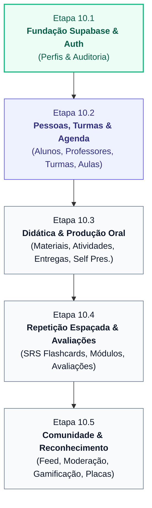

# PLANO DE MIGRAÇÃO PROGRESSIVA DOS REPOSITÓRIOS
**Plataforma DEMOSTRATIVO MTD — Método Paulo**

---

> **Documento:** Roteiro Ordenado de Migração da Camada de Dados (localStorage $\to$ Supabase)  
> **Versão:** 10.1.0  
> **Status:** Ativo / Vigente  

---

## 1. Estratégia de Migração Progressiva (Sem Regressão)

Para garantir que a aplicação continue operando perfeitamente e sem interrupções:
1. **Nenhum repositório é migrado de forma açodada:** Cada domínio terá sua tabela PostgreSQL, índices, triggers e políticas RLS validadas antes de conectar a interface.
2. **Desacoplamento por Fábrica (`repositoryFactory.ts`):** O seletor central chaveia entre `DemoLocalRepository` e `SupabaseRepository` com base em `APP_MODE`.
3. **Proibição de Fallback Silencioso em Produção:** Se um repositório for invocado em modo production sem o adaptador Supabase concluído, ele lança `UnimplementedSupabaseRepositoryError`, forçando a identificação imediata da pendência.

---

## 2. Ordem Recomendada de Migração por Subetapas

---

## 3. Matriz Detalhada dos 23 Repositórios

| Prioridade | Repositório | Dependências de Dados | Subetapa Alvo | Complexidade |
| :---: | :--- | :--- | :---: | :---: |
| **01** | `perfis` (Tabela Base) | `auth.users` | **Etapa 10.1 (Concluída)** | Média |
| **02** | `auditoria_logs` | `auth.users` | **Etapa 10.1 (Concluída)** | Baixa |
| **03** | `alunoRepository` | `perfis` | **Etapa 10.2** | Média |
| **04** | `professorRepository` | `perfis` | **Etapa 10.2** | Baixa |
| **05** | `turmaRepository` | `alunos`, `professores` | **Etapa 10.2** | Média |
| **06** | `aulaRepository` | `turmas`, `professores` | **Etapa 10.2** | Alta (4 estados) |
| **07** | `historicoNivelRepository` | `alunos`, `professores` | **Etapa 10.2** | Baixa (Auditoria) |
| **08** | `materialRepository` | `turmas`, `alunos`, `professores` | **Etapa 10.3** | Média (Sanitização) |
| **09** | `atividadeRepository` | `materiais`, `turmas` | **Etapa 10.3** | Média |
| **10** | `entregaRepository` | `atividades`, `alunos`, `professores`| **Etapa 10.3** | Alta (Versionamento) |
| **11** | `conteudoDiarioRepository` | `turmas`, `alunos` | **Etapa 10.3** | Baixa |
| **12** | `selfPresentationRepository` | `alunos`, `professores` | **Etapa 10.3** | Alta (Rubricas 1-5) |
| **13** | `baralhoRepository` | `professores`, `turmas` | **Etapa 10.4** | Média |
| **14** | `cartaoRepository` | `baralhos` | **Etapa 10.4** | Média |
| **15** | `progressoCartaoRepository`| `cartoes`, `alunos` | **Etapa 10.4** | Alta (Motor SM-2) |
| **16** | `historicoRevisaoRepository`| `cartoes`, `alunos` | **Etapa 10.4** | Média |
| **17** | `sessaoEstudoRepository` | `baralhos`, `alunos` | **Etapa 10.4** | Baixa |
| **18** | `programaRepository` | Nenhuma | **Etapa 10.4** | Baixa |
| **19** | `etapaRepository` | `programas` | **Etapa 10.4** | Baixa |
| **20** | `moduloRepository` | `etapas` | **Etapa 10.4** | Média (Critérios) |
| **21** | `progressoModuloRepository`| `modulos`, `alunos` | **Etapa 10.4** | Alta (Barreira Humana) |
| **22** | `avaliacaoRepository` | `modulos` | **Etapa 10.4** | Alta (Gabaritos) |
| **23** | `tentativaAvaliacaoRepository`| `avaliacoes`, `alunos` | **Etapa 10.4** | Alta (3 Políticas) |
| **24** | `comunidadeRepository` | `perfis`, `turmas` | **Etapa 10.5** | Alta (Moderação) |
| **25** | `gamificacaoRepository` | `alunos`, `aulas` | **Etapa 10.5** | Alta (Placas 8 fases) |

---

## 4. Checklist Técnico de Migração por Repositório

Para cada repositório durante sua respectiva subetapa:
1. Criar migração SQL em `supabase/migrations/` contendo schema, foreign keys, triggers e RLS.
2. Criar implementação `SupabaseXRepository` implementando `IXRepository`.
3. Adicionar mapeamento na fábrica `src/data/repositoryFactory.ts`.
4. Criar teste unitário específico do repositório garantindo que opera tanto em modo demo quanto com o cliente Supabase.
5. Manter sanitização de campos confidenciais (`observacoesInternas`) intacta.
