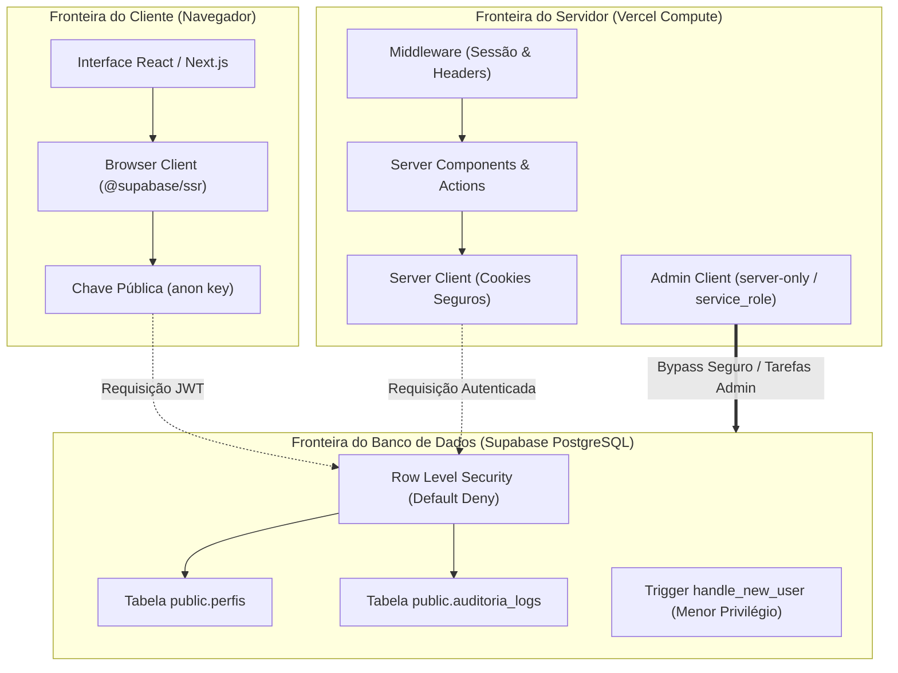

# ARQUITETURA DE SEGURANÇA DE BACKEND E RLS
**Plataforma DEMOSTRATIVO MTD — Método Paulo**

---

> **Documento:** Especificação Técnica de Segurança, Defesa em Profundidade e Governança de Dados  
> **Versão:** 10.1.0  
> **Status:** Ativo / Vigente  

---

## 1. Princípios de Segurança e Modelo de Ameaça

A arquitetura de segurança do **DEMOSTRATIVO MTD** é estruturada no princípio de **Defesa em Profundidade (Defense in Depth)** e **Privilégio Mínimo (Least Privilege)**, garantindo que mesmo se a interface for inspecionada ou manipulada no cliente, o backend rejeite acessos não autorizados.



---

## 2. Padrão de Negação Padrão (Default Deny RLS)

Todas as tabelas criadas no esquema `public` têm o Row Level Security explicitamente habilitado:
```sql
ALTER TABLE public.perfis ENABLE ROW LEVEL SECURITY;
ALTER TABLE public.auditoria_logs ENABLE ROW LEVEL SECURITY;
```

**Regras Fundamentais de RLS Adotadas:**
1. **Sem política explícita = Acesso Negado:** Nenhuma linha pode ser lida, inserida, alterada ou deletada a menos que uma política expressamente permita.
2. **Proibição de Políticas Permissivas Genéricas:** Políticas do tipo `USING (true)` ou `WITH CHECK (true)` para usuários autenticados são **terminantemente proibidas**.
3. **Isolamento de Alunos:** O discente consulta e interage exclusivamente com registros onde `auth.uid() = id` ou onde houver vínculo pedagógico legítimo comprovado no banco.
4. **Isolamento de Professores:** O corpo docente possui visibilidade restrita às suas turmas e alunos sob sua tutela, não tendo acesso às configurações globais de outros docentes ou credenciais administrativas.
5. **Logs de Auditoria Imutáveis:** A tabela `public.auditoria_logs` é configurada como append-only (sem políticas de `UPDATE` ou `DELETE`).

---

## 3. Diretrizes de Funções `SECURITY DEFINER`

Funções que precisam consultar dados com privilégios elevados para calcular papéis de acesso (como `public.get_auth_role()`, `public.is_admin()`, `public.is_professor_or_admin()`) seguem salvaguardas rígidas:

1. **`search_path` Fixado Rigorosamente:** Todas as funções declaram expressamente `SET search_path = public` para mitigar ataques de sequestro de caminho (*Search Path Hijacking*).
2. **Uso de `auth.uid()` Nativo:** As funções nunca aceitam parâmetros de ID de usuário manipuláveis pelo cliente; o identificador do ator é obtido diretamente do token de sessão criptografado pelo Supabase Auth.
3. **Modificador `STABLE`:** Assegura que o resultado da checagem de papel seja cacheado durante a execução de uma mesma query SQL, maximizando a performance do RLS sem comprometer a consistência.

---

## 4. Prevenção de Auto-Promoção e Menor Privilégio no Signup

A auto-promoção de usuários é bloqueada em duas camadas complementares:

### Camada 1: Trigger de Criação de Perfil (`handle_new_user`)
Mesmo que um agente malicioso envie metadados `{"role": "admin"}` durante a chamada de registro de usuário (`auth.signUp`), o trigger do banco ignora sumariamente o valor e força o papel `aluno`:
```sql
INSERT INTO public.perfis (id, email, nome_completo, role, status)
VALUES (NEW.id, NEW.email, v_nome, 'aluno', 'ativo');
```

### Camada 2: Cláusula `WITH CHECK` na Política de Atualização
A política `perfis_update_policy` permite que o discente atualize dados de perfil (nome, telefone, avatar), mas bloqueia tentativas de alterar o próprio `role` ou `status`:
```sql
WITH CHECK (
  public.is_admin()
  OR (
    auth.uid() = id
    AND role = (SELECT p.role FROM public.perfis p WHERE p.id = auth.uid())
    AND status = (SELECT p.status FROM public.perfis p WHERE p.id = auth.uid())
  )
);
```

---

## 5. Gerenciamento Seguro de Cookies e Clientes SSR no Next.js 14

Para evitar vazamento de credenciais e assegurar a compatibilidade com a arquitetura de Server Components:

1. **`Browser Client` (`src/lib/supabase/client.ts`):**
   - Utiliza exclusivamente `NEXT_PUBLIC_SUPABASE_URL` e `NEXT_PUBLIC_SUPABASE_ANON_KEY`.
   - NUNCA tem acesso à `SUPABASE_SERVICE_ROLE_KEY`.
2. **`Server Client` (`src/lib/supabase/server.ts`):**
   - Executado estritamente no servidor com cookies seguros (`httpOnly`, `sameSite=lax`, `secure`).
   - Assegura que a leitura de cookies em Server Components seja imutável, transferindo as escritas e refreshes para o middleware e server actions.
3. **`Admin Client` (`src/lib/supabase/admin.ts`):**
   - Protegido pela diretiva `import "server-only"`.
   - Qualquer tentativa acidental de importar este arquivo em um Client Component causa interrupção imediata na compilação do Next.js.
   - Restrito a operações de infraestrutura e rotinas de bootstrap.

---

## 6. Higienização de Dados e Campos Confidenciais

Nas próximas subetapas de migração dos repositórios para Supabase, os contratos de API continuarão mantendo a sanitização estrita já implementada no baseline:

| Campo Confidencial | Repositório / Entidade | Regra de Privacidade |
| :--- | :--- | :--- |
| `observacoesInternas` | `Material`, `Atividade` | Excluído de qualquer visualização discente |
| `observacoesInternas` | `SelfPresentation` | Deletado antes de entregar o parecer pedagógico |
| `observacoesInternas` | `TentativaAvaliacao` | Notas de correção interna da equipe destruídas |
| Respostas de Testes | `TentativaAvaliacao` | Ocultadas durante tentativa ativa conforme política |
| `observacoesInternas` | `SolicitacaoPlacaFisica` | Anotações da esteira de fabricação protegidas |
| Histórico de Denúncias | `Comunidade` | Sigilo ético de moderadores e denunciantes |
